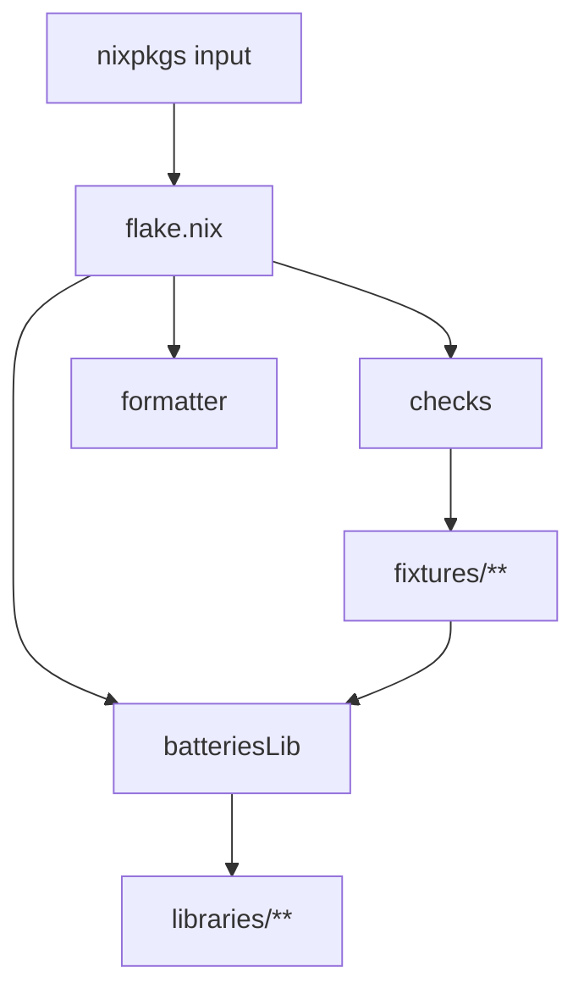

# nix-batteries (sidecar) — Library Toolkit Assessment

Self-contained brief for a third party reviewing this repository without prior
context. It states what the toolkit is, what it exports, how each export is
wired, what the fixtures actually prove, and what is knowingly unfinished.

Source of truth for behavior is `flake.nix` plus `libraries/`. This document is
descriptive; it is not a build recipe and not a contributor tutorial.

## Scope

Covered here:

- The public `batteriesLib` surface and the contract behind each entry.
- The data flow from flake inputs to each consumer-visible value.
- The validation boundary under `fixtures/` and what a green check buys.
- Known limitations, heuristics, and deferred work.

Not covered here:

- Continuous integration. No CI configuration exists in this repository; see
  [Known limitations](#known-limitations-and-deferred-work).
- The `hoagie` consumer repository. It is the current downstream user, but no
  library contract in this repository depends on it.

## What this repository is

A reusable Nix flake library toolkit. It declares one input (`nixpkgs`) and three
outputs (`batteriesLib`, `checks`, `formatter`) with no framework inputs. Library
implementations live under `libraries/`; validation lives under `fixtures/`.

The toolkit deliberately does not hide the Nix module system. Each entry in
`batteriesLib` is a plain function or attribute set with an explicit argument
shape; discovery helpers return data rather than importing behind the caller's
back.

Verified facts about the current tree:

- `batteriesLib` exposes exactly 11 names. `fixtures/default.nix` asserts the
  name list in both directions (`missingLibNames == []` and
  `unexpectedLibNames == []`), so an accidental addition or removal fails a
  check rather than passing silently.
- `formatter` is `pkgs.nixfmt` (nixfmt-rfc-style; 1.3.1 in the current lock) for
  every supported system.
- Supported systems are `x86_64-linux`, `aarch64-linux`, `x86_64-darwin`, and
  `aarch64-darwin`, fanned out by a local `forSystems` helper in `flake.nix`.

## Exported surface

| `batteriesLib` name   | Implementation                        | Contract shape                                                             |
| --------------------- | ------------------------------------- | -------------------------------------------------------------------------- |
| `dynamicAliases`      | `libraries/toolbox/dynamic-aliases`   | `{ discoverNixFileNames, mk }`                                             |
| `flakeRoot`           | `flake.nix` → `self.outPath`          | Path to the fetched source tree, for consumers that import directly        |
| `gitRepoState`        | `mkGitRepoState { }`                  | Shell snippets printing a short revision and dirty state at runtime        |
| `guardFlakeInput`     | `libraries/guard-flake-input`         | `name -> inputs -> { has, input, apply }`                                  |
| `helpLegendDecorator` | `libraries/decorators/help-legend`    | Layout composers plus `libHelpLegendRenderer.{posix,fish,nushell}`         |
| `mkGitRepoState`      | `libraries/toolbox/git-repo-state`    | Argument-taker variant of `gitRepoState`                                   |
| `modulette`           | `libraries/auto-discover/modulette`   | `{ discoverModules, hasValidHeader, hasHeaderPrefix }`                     |
| `modulon`             | `libraries/auto-discover/modulon`     | `collectorArgs -> { imports = [ path ]; }`                                 |
| `nixOptionsToMd`      | `libraries/toolbox/nix-options-to-md` | `{ lib, options, namespace ? "myOptions" } -> { allEntries, markdown, … }` |
| `themeOptionModule`   | `libraries/themes/default.nix`        | A module function declaring `myOptions.hm.data.theme.{name,enableColors}`  |
| `themes`              | `libraries/themes/resolver.nix`       | Theme discovery, validation, rendering, and selection                      |

`themeOptionModule` is exported as a module for `imports` or a discovery helper,
so consumers never need to reach into this repository's source tree by path.

## How the surface is wired



```text
flake.nix → batteriesLib → libraries/<module>
flake.nix → fixtures/default.nix → checks.<system>
fixtures/default.nix → per-fixture module → assert + pass → runCommand
```

Each public name maps onto one implementation directory. There is no
intermediate registry, so reading `flake.nix` is sufficient to enumerate the
public API and its argument shapes.

## Component contracts

### `modulon` — Nix module auto-discovery

Owner of the `imports` list. `collectorArgs` accepts `dirs`, `excludePaths`, and
`extraModules`; the result is `{ imports = [ <path> ]; }`. Modules are collected
by recursive `builtins.readDir` plus `builtins.readFile`, and a file is kept only
when it lacks `@MODULON_SKIP` and matches at least 2 of 11 content patterns.
Files named `configuration.nix`, `flake.nix`, `hardware-configuration.nix`, and
`home.nix` are excluded unconditionally, as are path-infix matches for `.git/`
and `/tests/` by default. `extraModules` bypass every exclusion rule.

The detection is explicitly heuristic; the source states that the patterns "help
filter out non-module `.nix` files" and that requiring 2+ patterns reduces false
positives. A non-module `.nix` file that happens to match two patterns is
therefore discoverable, and a module whose content matches fewer than two
patterns is not.

### `modulette` — header-validated passive data discovery

Owns flat and directory discovery of data modules. `discoverModules` scans
`directory` with `builtins.readDir`, keys the result by file basename or
subdirectory name, imports each accepted entry with the caller's `args`, and
merges the results. First-line header enforcement is optional; when both header
arguments are `null` every candidate is accepted.

Failure behavior is deliberate: an unknown `mode` throws, and in directory mode a
scanned subdirectory without `targetFile` fails with a Modulette error naming the
directory and the expected file rather than surfacing a bare import error. The
fixture asserts that failure through `tryEval`.

### `guard-flake-input` — optional flake-input handling

Turns an absent flake input from a build failure into a `builtins.trace` notice.
The guard returns `{ has, input, apply }`; lookups are by exact attribute name, so
consumers that normalize input keys pass the normalized set. The guard never
throws. `fixtures/default.nix` asserts the missing-input path returns
`has == false` and `input == null`.

### `help-legend` — presentation layout plus shell renderers

Two concerns are separated on purpose: layout metrics (shared) and shell syntax
(per renderer). Exposed composers are `sectionLayout`, `mkHelpSection`,
`mkCenteredTitle`, `mkHelpCheck`, plus the layout helpers `repeat`,
`maxStringLength`, `maxInt`, `centerIn`, and `enabledWidth`.

`libHelpLegendRenderer.{posix,fish,nushell}` each implement `print`, `escape`, and
`helpCheck`. The composers apply `escape` to every caller-authored string —
command names, descriptions, section names, titles — so `$`, quotes, backticks,
and literal backslashes reach the terminal as written instead of being expanded
by the target shell.

Each renderer maps the theme's ANSI `\e` prefix onto what its own printer
understands. `escape` and colour handling are separate problems and use separate
encodings:

| Renderer  | Print primitive      | Payload backslash   | ANSI colour prefix | Help argument          |
| --------- | -------------------- | ------------------- | ------------------ | ---------------------- |
| `posix`   | `printf '%b'`        | `\0134`             | `\033`             | `$1` for `-h`/`--help` |
| `fish`    | `printf '%b'`        | `\\\\` (quadrupled) | `\e`               | `$argv[1]`             |
| `nushell` | `print --no-newline` | `\u{5c}`            | `\u{1b}`           | native `-h`/`--help`   |

The POSIX renderer avoids `\e` because `printf '%b'` only recognizes it in shells
that extend POSIX; dash prints it literally. `\033` renders as ESC in every
implementation tested (`dash`, `bash`, `zsh`, `fish`). The octal payload
backslash is what makes the colour rewrite safe: since a payload backslash can
only appear as `\0134`, no caller-authored text can forge the `\e` sequence the
rewrite looks for.

### `themes` — theme data, validation, and resolution

An atomic pipeline: `discovery.nix` finds theme files, `assertions.nix` enforces
the source contract, `normalizer.nix` fixes defaults and the canonical shape,
`colors.nix` and `ansi-renderer.nix` render, `provenance.nix` records provider
and source, and `resolver.nix` exposes the result. There is no shared palette or
fallback color source; a theme is complete and readable in isolation.

Nine semantic roles are required (`accent`, `emphasis`, `option`, `success`,
`value`, `warning`, `error`, `notice`, `context`). Each role renders into three
presentations derived from its own color, never from its name, so an optional
extra role gains `base`, `bold`, and `dim` entries with no library edit.
`selection` is a reserved role name and is published as a raw
`{ background, foreground }` pair instead.

Validation is strict: every role and selection value must match `#RRGGBB`
exactly. Failures report the theme name and the offending or missing keys.
`enableColors = false` resolves all rendered codes to empty strings and
`colors` to `null`, which is an explicit absence consumers can test rather than
an empty hex value.

Provenance is explicit rather than inferred: `themeMetadata.<name>` records
`{ provider, source }` for every discovered theme, and the fixture asserts the
value for a fixture theme.

### Toolbox — small runtime generators

- `dynamic-aliases` maps names or entry attribute sets through caller-supplied
  `nameFor`/`valueFor`/`legendFor` callbacks into `{ names, aliasNames, aliases,
legend, group }`. Duplicate generated names throw. Unknown extra attributes are
  ignored for backwards compatibility. Rendering is out of scope.
- `git-repo-state` emits shell functions that print a short revision and dirty
  state **at runtime**; it does not read Git metadata during evaluation. The
  `posix` variants stay inside POSIX grammar so `dash`, `bash`, and `zsh` execute
  them as generated. Consumers own labels, colors, and placement.
- `nix-options-to-md` converts a nested `mkOption` tree into Markdown rows. It
  does not evaluate a module system, discover files, write to disk, or know any
  project namespace.

## Validation boundary

`fixtures/` holds small deterministic fixture trees, one narrow contract each.
`fixtures/default.nix` aggregates them into `checks.<system>` and asserts the
exact `batteriesLib` name list, the theme option module's declared option names
and defaults, and every focused contract. Checks and the formatter cover all four
supported systems.

```sh
nix flake check path:. --all-systems --offline \
  --no-update-lock-file --no-write-lock-file --no-build
```

`path:.` is required when the working tree contains untracked fixture files,
because it evaluates the working tree rather than the Git-tracked tree.
`--no-build` evaluates every check without building its trivial `pass`
derivation, which is where assertion failures surface during evaluation; the same
execution without `--no-build` builds the checks.

Twelve checks currently exist: `batteriesLib-surface`, `consumer-fixture`,
`decorator-fixture`, `dynamic-aliases-fixture`, `guard-flake-input-fixture`,
`modulette-directory-fixture`, `modulette-fixture`, `modulon-fixture`,
`nix-options-to-md-fixture`, `renderer-runtime-fixture`,
`theme-validation-fixture`, and `themes-fixture`.

`renderer-runtime-fixture` is the only check that executes generated code. It
runs `bash -n`, `zsh -n`, and `dash -n` over the generated POSIX sources,
`fish --no-execute` over the Fish sources, and `nu-check` over the Nushell
sources, then executes a payload containing `$`, `"`, a backtick, and a literal
backslash through every shell and greps for byte-identical survival. It also
asserts that the Nushell source carries `\u{1b}[` and never a literal `\e[` or a
raw ESC byte, and that the dash output actually carries ESC bytes rather than a
printed `\e[` sequence.

`fixtures/consumer/` is a standalone flake whose only input is `path:../..`. It
proves that public helper calls, theme resolution, `flakeRoot`-based direct
imports, and `mkGitRepoState` argument forwarding work through the public flake
boundary. Its lock graph is transient and is not committed, so resolving it on a
cold store requires network access.

## Verified behaviour

Everything below was executed, not inferred.

| Claim                                                  | How it was checked                                                                    |
| ------------------------------------------------------ | ------------------------------------------------------------------------------------- |
| All twelve checks evaluate without assertion failure   | `nix flake check path:. --all-systems --offline … --no-build`                         |
| Two `pass` derivations build for real                  | `nix build path:.#checks.aarch64-darwin.{batteriesLib-surface,decorator-fixture}`     |
| Changed Nix files parse and are nixfmt-clean           | `nix-instantiate --parse` plus `nixfmt --check` on every changed file                 |
| A hostile payload survives verbatim in 5 shells        | Generated help sources executed under `dash`, `bash`, `zsh`, `fish`, `nu`             |
| `dash` renders colours, not literal `\e`               | ESC present in dash output; no literal `\e[`; output byte-identical to `bash`/`zsh`   |
| Nushell keeps colours after the escape change          | `nu-check` clean; output carries ESC and the payload byte-for-byte                    |
| `gitRepoState` POSIX variants run under `dash`         | `GIT_REPO_PATH` exported into `/bin/dash`; printed the short hash, no `[[: not found` |
| The consumer fixture resolves through the public flake | `consumer-fixture` check passes                                                       |

Environment caveat: this machine cannot build the locked `pkgs.dash` derivation
offline (`dash` 0.5.13.3 pulls `bmake`, which is not in the local store), so
`renderer-runtime-fixture` evaluates but cannot build here. Runtime shell
verification was therefore performed by executing the generated sources directly
against `/bin/dash` and the store paths for `bash`, `zsh`, `fish`, and `nu`. The
fixture keeps `pkgs.dash` because that is correct for a machine with full store
access.

## Known limitations and deferred work

- **No CI.** Nothing runs `nix flake check` automatically; it is a manual step.
  There is no formatting check in a pipeline either.
- **`modulon` detection is heuristic.** Content-pattern counting over file text
  is approximate by construction. `@MODULON_SKIP` is the escape hatch, and
  `extraModules` bypasses exclusion entirely.
- **`modulette` directory mode depends on the target file.** A subdirectory
  without `targetFile` aborts evaluation by design. Header validation is a
  first-line string convention; `hasValidHeader` and `hasHeaderPrefix` read the
  file blindly and error on a missing file.
- **`escape` is a shell-specific contract, not a universal one.** The three
  renderers encode the same payload differently because the shells differ. Any
  new renderer must define its own `escape`, `print`, and `helpCheck`, and the
  runtime fixture is where that contract is proven.
- **Theme colour codes carry a literal `\e`.** `ansi-renderer.nix` emits `\e[`
  with no leading ESC byte, so consumers must print them through something that
  expands `\e` (`printf '%b'`) or translate them, as each help-legend renderer
  does. Consumers that embed the code in a context that does not expand escapes
  will print the escape text.
- **`colorOperations.hexColorToRgb` assumes validated input.** It is tolerant in
  practice, but `#RRGGBB` validation is enforced upstream by `assertions.nix`.
- **`fixtures/consumer/` needs network on a cold cache.** Its `path:../..` input
  has no committed lock.
- **Dependency updates are manual.** `flake.lock` pins `nixpkgs`, but nothing
  enforces freshness or reviews lock drift.

## Assessment hooks

The most useful places for an external reviewer to push:

1. `modulon` pattern table and the `>= 2` threshold — accuracy against a large
   real module tree.
2. The per-renderer `escape` tables — whether each is complete for its shell,
   including characters not yet covered by the fixture payload.
3. The theme validation surface — whether the `#RRGGBB` requirement and the
   reserved-role rules are the right contract for third-party themes.
4. Whether exported `themeOptionModule` option names and defaults are the right
   ones to freeze, given they are asserted in `fixtures/default.nix`.
5. The absence of CI, and what a minimal check pipeline would need to cover.

## Where to look next

- `flake.nix` — the only place the public surface is built.
- [`README.md`](README.md) — toolkit overview and directory roles.
- [`fixtures/README.md`](fixtures/README.md) — the validation boundary and fixture rules.
- [`fixtures/default.nix`](fixtures/default.nix) — the asserted public surface and name list.
- [`libraries/auto-discover/modulon/README.md`](libraries/auto-discover/modulon/README.md) — discovery model and its `docs/` set.
- [`libraries/auto-discover/modulette/README.md`](libraries/auto-discover/modulette/README.md) — flat and directory discovery.
- [`libraries/guard-flake-input/README.md`](libraries/guard-flake-input/README.md) — optional input handling.
- [`libraries/decorators/help-legend/README.md`](libraries/decorators/help-legend/README.md) — layout contract.
- [`libraries/decorators/help-legend/renderers/README.md`](libraries/decorators/help-legend/renderers/README.md) — renderer matrix and escape rules.
- [`libraries/themes/README.md`](libraries/themes/README.md) — role contract, rendering rules, and resolution API.
- [`libraries/toolbox/git-repo-state/README.md`](libraries/toolbox/git-repo-state/README.md) — runtime Git helpers.
- [`libraries/toolbox/nix-options-to-md/README.md`](libraries/toolbox/nix-options-to-md/README.md) — option catalog rendering.
- [`libraries/toolbox/dynamic-aliases/README.md`](libraries/toolbox/dynamic-aliases/README.md) — alias and legend generation.
