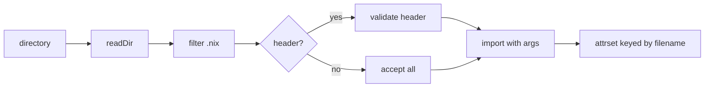
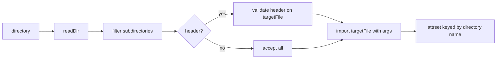

# Modulette

Lightweight Nix module discovery — scans directories, validates optional headers, and imports `.nix` files into an attrset.

## Modes

Modulette operates in two modes, selected by the required `mode` parameter:

| Mode          | Scans                         | Keys by                    | Imports                               |
| ------------- | ----------------------------- | -------------------------- | ------------------------------------- |
| `"flat"`      | `.nix` files in a directory   | Filename without extension | Each matching file                    |
| `"directory"` | Subdirectories in a directory | Directory name             | `targetFile` inside each subdirectory |

## Exports

| Function          | Description                                                    |
| ----------------- | -------------------------------------------------------------- |
| `discoverModules` | Scan directory, filter by header, import, collect into attrset |
| `hasValidHeader`  | Exact first-line match (string or list of strings)             |
| `hasHeaderPrefix` | Prefix match (allows comments after the header)                |

## Function Reference

### `discoverModules`

Scans a directory in flat or directory mode, validates optional headers, imports matching entries with the given args, and collects results into an attrset.

#### Flat mode

Scans for regular `.nix` files directly inside the directory. Directories whose
names end in `.nix` are ignored. Keys by filename without `.nix` extension.

```nix
modulette.discoverModules {
  mode = "flat";
  directory = ./my-data-modules;
  headerPrefix = "# My data module.";
  args = { inherit color; };
  exclude = [ "default.nix" ];
}
```

#### Directory mode

Scans for subdirectories inside the directory. Each subdirectory is treated as a named entry; the file specified by `targetFile` (default: `"host.nix"`) inside each subdirectory is imported. Keys by directory name. Every candidate subdirectory must contain `targetFile`; a subdirectory without it fails evaluation with a Modulette error that names the directory and the expected file.

```nix
modulette.discoverModules {
  mode = "directory";
  directory = ./hosts;
  targetFile = "host.nix";
  args = { inherit inputs; };
}
```

Given this layout:

```
hosts/
  maru/
    host.nix
  tenten/
    host.nix
```

Directory mode returns `{ maru = <imported>; tenten = <imported>; }`.

#### Parameters

| Parameter      | Type                      | Default      | Description                                                               |
| -------------- | ------------------------- | ------------ | ------------------------------------------------------------------------- |
| `mode`         | `"flat"` or `"directory"` | (required)   | Scanning mode                                                             |
| `directory`    | path                      | (required)   | Path to scan                                                              |
| `args`         | attrset                   | `{ }`        | Attrset passed to each imported module                                    |
| `exclude`      | list of strings           | `[ ]`        | Names to skip (filenames in flat mode, directory names in directory mode) |
| `headerPrefix` | string                    | `null`       | Prefix that the first line must start with                                |
| `headerText`   | string or list of strings | `null`       | Exact first-line string(s) to match                                       |
| `targetFile`   | string                    | `"host.nix"` | Filename to import inside each subdirectory (directory mode only)         |

When both `headerText` and `headerPrefix` are `null`, all entries are accepted.

### `hasValidHeader`

Checks whether a file's first line exactly matches a header string or any string in a list.

```nix
modulette.hasValidHeader "# My data module." ./my-data-modules/colors.nix
# → true or false

modulette.hasValidHeader [ "# POSIX module." "# Fish module." ] ./some-file.nix
# → true if first line matches either string
```

### `hasHeaderPrefix`

Checks whether a file's first line starts with the given prefix. More permissive than `hasValidHeader` — allows additional text after the prefix.

```nix
modulette.hasHeaderPrefix "# Theme module." ./themes/nushell-inspired.nix
# Matches: "# Theme module. Nushell-inspired color scheme."
```

## Layout Model

### Flat mode



### Directory mode



## Implementation Examples

### Basic: flat directory with header validation

A directory of data modules that all share the same header convention:

```nix
let
  modulette = import ./modulette { inherit lib; };
in
modulette.discoverModules {
  mode = "flat";
  directory = ./themes;
  headerPrefix = "# Theme module.";
  args = { inherit lib };
}
# Returns: { nushell-inspired = <imported>; dracula = <imported>; ... }
```

### Directory mode: host registry

A directory of host definitions, each in its own subdirectory:

```nix
let
  modulette = import ./modulette { inherit lib; };
in
modulette.discoverModules {
  mode = "directory";
  directory = ./config/hosts;
  targetFile = "host.nix";
  args = { inherit inputs; };
}
# Returns: { maru = <imported>; tenten = <imported>; ... }
```

### Shell-specific importer with key validation

When modules must return specific keys (e.g., `aliases` + `functions` for POSIX, `abbrs` + `functions` for fish), use `hasValidHeader` to filter by shell and validate the return shape:

```nix
let
  modulette = import ./modulette { inherit lib; };

  importPosixCommandModules =
    { args, directory }:
    let
      # 1. Discover all .nix files in the directory
      entryTypes = builtins.readDir directory;
      entries = builtins.attrNames entryTypes;
      nixFiles = builtins.filter
        (name: entryTypes.${name} == "regular" && lib.hasSuffix ".nix" name)
        entries;

      # 2. Filter by POSIX header
      fullPaths = map (f: directory + "/${f}") nixFiles;
      validFiles = builtins.filter
        (modulette.hasValidHeader "# POSIX shell command module. Do not remove this header.")
        fullPaths;

      # 3. Import and validate expected keys
      results = map (
        file:
        let
          result = (import file) args;
          missingKeys = builtins.filter (key: !(builtins.hasAttr key result)) [ "aliases" "functions" ];
        in
        if missingKeys != [ ] then
          throw "Module ${file} missing key(s): ${lib.concatStringsSep ", " missingKeys}"
        else
          result
      ) validFiles;
    in
    {
      allAliases = builtins.foldl' (a: b: a // b.aliases) { } results;
      allFunctions = builtins.concatStringsSep "\n" (map (r: r.functions) results);
    };
in
importPosixCommandModules {
  directory = ./commands;
  args = { inherit config hostKind lib; };
}
```

### Subdirectory scanning with shared data files

When related modules and their shared data files are grouped in a subdirectory (e.g., `ai/posix-ai.nix` + `ai/prompts.nix`), scan all `.nix` files in all subdirectories. Header validation filters out non-module files:

```nix
let
  modulette = import ./modulette { inherit lib; };

  # Collect all .nix files from all subdirectories
  subNixFiles = builtins.concatLists (
    map (
      name:
      let
        subDir = directory + "/${name}";
        subEntryTypes = builtins.readDir subDir;
        subEntries = builtins.attrNames subEntryTypes;
      in
      map (f: subDir + "/${f}") (
        builtins.filter
          (name: subEntryTypes.${name} == "regular" && lib.hasSuffix ".nix" name)
          subEntries
      )
    ) allSubdirs
  );

  # All candidate paths: top-level + subdirectory files
  fullPaths =
    (map (f: directory + "/${f}") nixFiles)
    ++ subNixFiles;

  # Header validation filters out non-module files (e.g., prompts.nix)
  validFiles = builtins.filter
    (modulette.hasValidHeader "# POSIX shell command module. Do not remove this header.")
    fullPaths;
in
# validFiles contains only posix-ai.nix — prompts.nix is excluded by header check
```

This allows grouping a module with its shared data without needing any bridge files:

```
commands/
  ai/
    posix-ai.nix      ← header: "# POSIX shell command module..."  ✅ loaded
    fish-ai.nix       ← header: "# Fish shell command module..."    ✅ loaded by fish importer
    nushell-ai.nix    ← header: "# Nushell command module..."       ✅ loaded by nushell importer
    prompts.nix       ← no module header                            ❌ filtered out
  posix-git.nix       ← header: "# POSIX shell command module..."  ✅ loaded
  ...
```

### Header prefix matching for extensible modules

Use `hasHeaderPrefix` when modules share a common prefix but have varying suffixes (e.g., theme-specific descriptions):

```nix
# Accepts any file whose first line starts with "# Theme module."
modulette.discoverModules {
  mode = "flat";
  directory = ./themes;
  headerPrefix = "# Theme module.";
  args = { inherit lib; };
}
```

Matches:

- `# Theme module.` ✅
- `# Theme module. Nushell-inspired color scheme.` ✅
- `# Some other header` ❌

### Multiple valid headers

When a directory contains modules with different but known headers, pass a list to `headerText`:

```nix
modulette.discoverModules {
  mode = "flat";
  directory = ./mixed-modules;
  headerText = [ "# POSIX module." "# Bash-only module." ];
  args = { inherit lib; };
}
```

### Full example: shell command importer

A real-world consumer module that mirrors the `commands.nix` pattern used in this
project. Shows a shared core function called by shell-specific wrappers, with
subdirectory scanning and key validation.

```nix
{ lib, libModulette }:
let
  modulette = libModulette;

  /*
    Core: shared importer called by each shell-specific wrapper.
    Scans the directory for command modules:
      1. Top-level .nix files (e.g., posix-git.nix, fish-git.nix)
      2. All .nix files in immediate subdirectories — header validation
         filters out non-module files (e.g., prompts.nix, default.nix).
  */
  importCommandModulesByShell =
    { args, directory, expectedKeys, filePrefix ? null, headerText }:
    let
      entryTypes = builtins.readDir directory;
      entries = builtins.attrNames entryTypes;
      # 1. Top-level .nix files (e.g., posix-git.nix, fish-git.nix)
      nixFiles = builtins.filter
        (name: entryTypes.${name} == "regular" && lib.hasSuffix ".nix" name)
        entries;
      # All subdirectories in the directory
      allSubdirs = builtins.filter (name: entryTypes.${name} == "directory") entries;
      # 2. Collect all .nix files from all subdirectories
      subNixFiles = builtins.concatLists (
        map (
          name:
          let
            subDir = directory + "/${name}";
            subEntryTypes = builtins.readDir subDir;
            subEntries = builtins.attrNames subEntryTypes;
          in
          map (f: subDir + "/${f}") (
            builtins.filter
              (entry: subEntryTypes.${entry} == "regular" && lib.hasSuffix ".nix" entry)
              subEntries
          )
        ) allSubdirs
      );
      # All candidate paths
      fullPaths =
        (map (f: directory + "/${f}") nixFiles)
        ++ subNixFiles;
      # Header validation filters out non-module files
      validFiles = builtins.filter (modulette.hasValidHeader headerText) fullPaths;
      # Import and validate expected keys
      results = map (
        file:
        let
          result = (import file) args;
          missingKeys = builtins.filter (key: !(builtins.hasAttr key result)) expectedKeys;
        in
        if missingKeys != [ ] then
          throw "Shell command module ${file} is missing expected key(s): ${lib.concatStringsSep ", " missingKeys}. Expected keys: ${lib.concatStringsSep ", " expectedKeys}"
        else
          result
      ) validFiles;
    in
    results;

  # POSIX: { aliases, functions } per module
  importPosixCommandModules =
    { args, directory }:
    let
      results = importCommandModulesByShell {
        inherit args directory;
        headerText = "# POSIX shell command module. Do not remove this header.";
        expectedKeys = [ "aliases" "functions" ];
      };
    in
    {
      allAliases = builtins.foldl' (a: b: a // b.aliases) { } results;
      allFunctions = builtins.concatStringsSep "\n" (map (r: r.functions) results);
    };

  # Fish: { abbrs, functions } per module
  importFishCommandModules =
    { args, directory }:
    let
      results = importCommandModulesByShell {
        inherit args directory;
        headerText = "# Fish shell command module. Do not remove this header.";
        expectedKeys = [ "abbrs" "functions" ];
      };
    in
    {
      allAbbrs = builtins.foldl' (a: b: a // b.abbrs) { } results;
      allFunctions = builtins.concatStringsSep "\n" (map (r: r.functions) results);
    };

  # Nushell: { aliases, functions } per module
  importNushellCommandModules =
    { args, directory }:
    let
      results = importCommandModulesByShell {
        inherit args directory;
        headerText = "# Nushell command module. Do not remove this header.";
        expectedKeys = [ "aliases" "functions" ];
      };
    in
    {
      allAliases = builtins.foldl' (a: b: a // b.aliases) { } results;
      allFunctions = builtins.concatStringsSep "\n" (map (r: r.functions) results);
    };
in
{
  inherit
    importCommandModulesByShell
    importFishCommandModules
    importNushellCommandModules
    importPosixCommandModules
    ;
}
```

Usage from a shell HM module:

```nix
let
  importLib = import (flakeRoot + "/config/shared/data-modules/applications/cli-shell/commands.nix") {
    inherit lib libModulette;
  };
  commands = importLib.importPosixCommandModules {
    directory = flakeRoot + "/config/shared/data-modules/applications/cli-shell/commands";
    args = { inherit config hostKind lib; };
  };
in
{
  programs.zsh.shellAliases = commands.allAliases;
  programs.zsh.initContent = commands.allFunctions;
}
```
