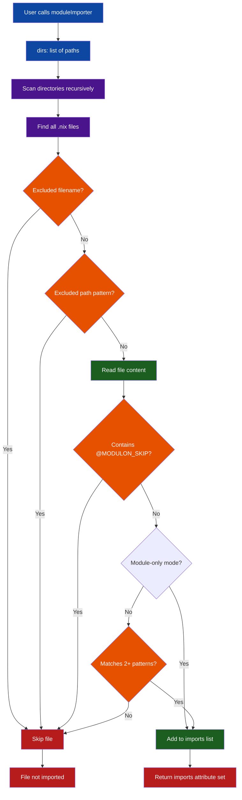

# How Modulon Works

Modulon builds an import list from declared roots. Module-only mode selects
regular `.nix` files after exclusions; the default heuristic mode additionally
checks source text. Neither mode evaluates files or proves they are modules.

When a nearby file should not be imported, add `@MODULON_SKIP`. That keeps data
modules, helper modules, and parked work-in-progress files close to the code
they support without letting them leak into the module graph.

## Module Discovery Flow



## Key Benefits

- **Automatic Discovery** — Add new modules without updating import lists
- **Drop-in Scaling** — Grow a module tree by adding files, not by maintaining a second registry
- **Explicit Discovery Mode** — Module-only roots avoid source guessing; heuristic mode remains available for mixed-tree compatibility
- **Local Skips** — Use `@MODULON_SKIP` to keep non-imported files beside related modules
- **Flexible Configuration** — Easily specify directories to scan and paths/patterns to exclude
- **Works Everywhere** — Compatible with NixOS, Home Manager, and other Nix module systems

## The Discovery Process

The core of Modulon is exposed as `nix-batteries.batteriesLib.modulon`. When called, this
function:

1. Recursively scans the directories specified in the `dirs` option for files ending in `.nix`
2. Prunes excluded directory components before recursion and excludes matching files and default filenames
3. Reads the content of the remaining `.nix` files
4. Excludes `@MODULON_SKIP` files; in heuristic mode, requires at least two source patterns
5. Returns `{ imports = [ ... ]; }` with candidate paths and explicit additions

## Module Detection Patterns

The compatibility heuristic looks for these patterns, including inside comments:

```nix
modulePatterns = [
  "... }:"
  "}:"
  "config,"
  "lib,"
  "inputs,"
  "nixosConfig,"
  "pkgs,"
  "config = {"
  "home = {"
  "imports = ["
  "options."
];
```

A file must match at least two patterns in heuristic mode. A plain attrset module
may be missed, while a comment containing `config, lib,` can admit a non-module.
Module-only mode skips this classifier; one invalid selected file then causes
module evaluation to fail. Exclusion matching uses whole components below each
root; ancestors and partial directory names never affect the result.

## Error Handling

If a directory specified in `dirs` doesn't exist, Modulon will fail with a clear error message:

```
Modulon: Directory '/path/to/dir' does not exist
```
