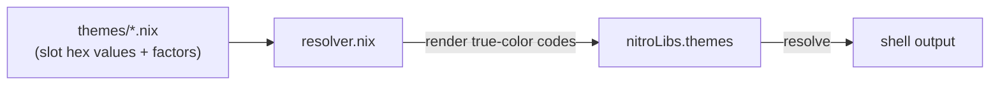

# Themes

Self-contained true-color themes for terminal output. Each theme owns the
`#RRGGBB` values assigned to semantic numbered slots. The resolver validates
the theme, applies its bold and dim factors, and renders 24-bit foreground
escape codes.

Theme files are auto-discovered via Modulette. Add a `.nix` file with the
required header and it becomes available through `nitroLibs.themes`.

## Architecture

The system has two ownership layers:

1. **Theme** (`themes/*.nix`) — owns slot colors, `boldFactor`, and
   `dimFactor`.
2. **Consumer** — references only rendered semantic slots such as
   `bold_zero`, `dimmed_one`, or `five`.



There is no shared palette or fallback color source. A theme is complete and
readable in isolation.

## Rendering rules

Slot names declare their rendering behavior:

| Name pattern  | Rendering                                                                  |
| ------------- | -------------------------------------------------------------------------- |
| `zero`        | Original RGB rendered as a regular 24-bit foreground                       |
| `bold_zero`   | RGB multiplied by `boldFactor`, clamped to 255, and rendered with SGR bold |
| `dimmed_zero` | RGB multiplied by `dimFactor` and rendered as a regular 24-bit foreground  |

Both factors are non-negative numbers. Their defaults are:

```nix
boldFactor = 1.0;
dimFactor = 0.55;
```

The scaling formula for each RGB channel is
`min 255 (floor (channel * factor))`.

Dimmed slots use scaled RGB instead of the SGR faint attribute. Faint rendering
varies across terminals and can shift 24-bit colors unpredictably.

## Slot contract

Every bundled theme defines the regular and bold forms of slots zero through
seven, plus the two common dimmed slots:

| Slot family | Role                                          |
| ----------- | --------------------------------------------- |
| `zero`      | Primary accent, success, headers, positive    |
| `one`       | Text emphasis                                 |
| `two`       | Tertiary accent, section highlight            |
| `three`     | Callout or alternative highlight              |
| `four`      | Warning or important highlight                |
| `five`      | Error or danger                               |
| `six`       | State change, dirty state, or secondary alert |
| `seven`     | Location, host, path, or contextual accent    |

Required rendered keys are:

- `zero` through `seven`
- `bold_zero` through `bold_seven`
- `dimmed_zero` and `dimmed_one`

Themes may add specialized slots. `311amber`, for example, also provides
`two_light` and `bold_two_light`.

Mode codes remain theme-independent:

| Attribute        | Code    | Role                          |
| ---------------- | ------- | ----------------------------- |
| `mode.reset`     | `\e[0m` | Reset all text attributes     |
| `mode.dim`       | `\e[2m` | Dim or faint text             |
| `mode.italic`    | `\e[3m` | Italic text                   |
| `mode.underline` | `\e[4m` | Underlined text               |
| `mode.blink`     | `\e[5m` | Blinking text                 |
| `mode.reverse`   | `\e[7m` | Reverse foreground/background |

## Theme format

Theme values are flat and use the same names exported to consumers. A
recursive slot attrset lets variants reuse a prime color without repeating its
hex value:

```nix
# Theme module. Do not remove this header.
{ }:
{
  boldFactor = 1.0;
  dimFactor = 0.55;

  slots = rec {
    zero = "#4a6fa5";
    one = "#f8fafc";
    two = "#06b6d4";
    three = "#d946ef";
    four = "#f59e0b";
    five = "#ef4444";
    six = "#ff6600";
    seven = "#22c55e";

    bold_zero = zero;
    bold_one = one;
    bold_two = two;
    bold_three = three;
    bold_four = four;
    bold_five = five;
    bold_six = six;
    bold_seven = seven;

    dimmed_zero = zero;
    dimmed_one = one;
  };
}
```

Every slot value must use the exact `#RRGGBB` form. Factors and slot values are
validated before rendering. Missing required slots report the theme name and
the complete missing-slot list.

## Quick start

Add the flake and obtain the public theme library:

```nix
inputs.nitro.url = "github:your-org/nix-nitro";

outputs = { nitro, ... }:
let
  libThemes = nitro.nitroLibs.themes;
in
{
  # ...
};
```

Resolve one theme before passing it to consumers:

```nix
let
  colors = libThemes.resolve {
    name = "311amber";
    enableColors = true;
  };
in
''
  printf '%b' "${colors.theme.bold_zero}OK${colors.mode.reset}"
  printf '%b' "\n${colors.theme.bold_four}WARN${colors.mode.reset}"
  printf '%b' "\n${colors.theme.bold_five}ERROR${colors.mode.reset}"
''
```

When `enableColors = false`, all theme slots and mode codes resolve to empty
strings. Output structure remains unchanged without conditional rendering in
each consumer.

## Home Manager integration

Select the theme through the host profile:

```nix
myOptions.hm.data.theme = {
  enableColors = true;
  name = "311amber";
};
```

`enableColors = null` is the module default and lets the consuming
configuration decide whether active shells should enable colors.

Resolve once and pass the selected `{ theme, mode }` value downstream through
`extraSpecialArgs` or `_module.args`. Consumers should not select themes or
interpret factors themselves.

## Bundled themes

| Theme            | Source or intent                                   |
| ---------------- | -------------------------------------------------- |
| 311amber         | Custom vintage amber phosphor CRT                  |
| catppuccin-mocha | Official Catppuccin Mocha colors                   |
| dracula          | Official Dracula OSS colors                        |
| gruvbox-dark     | Official Gruvbox dark bright colors                |
| nord             | Official Nord Frost, Snow Storm, and Aurora colors |
| nushell-inspired | Nushell default terminal color roles               |
| steel            | Custom muted blue with Tailwind-inspired accents   |

The selected theme name is the filename without `.nix`. An unknown name throws
with the list of available themes.

## API

| Attribute                        | Description                                                  |
| -------------------------------- | ------------------------------------------------------------ |
| `theme.*`                        | Rendered flat slot constants for every bundled theme         |
| `mode.blink`                     | Blinking text                                                |
| `mode.dim`                       | Dim or faint text                                            |
| `mode.italic`                    | Italic text                                                  |
| `mode.reset`                     | Reset all text attributes                                    |
| `mode.reverse`                   | Reverse foreground and background                            |
| `mode.underline`                 | Underlined text                                              |
| `select name`                    | Return one theme as `{ theme, mode }`                        |
| `withoutColors libThemes`        | Replace every slot and mode code with `""`                   |
| `resolve { name, enableColors }` | Select a theme and optionally strip all color and mode codes |

## Where to look next

- [Theme files](themes/README.md) — authoring and validation details
- [Modulette](../auto-discover/modulette/README.md) — header-validated discovery
- [help-legend renderers](../decorators/help-legend/renderers/README.md) — shell-native consumers
