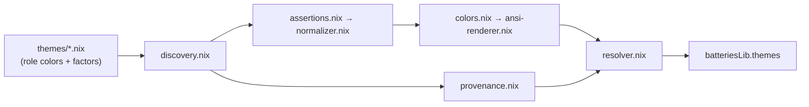

# Themes

Self-contained true-color themes for terminal output and interactive selectors.
Each theme owns its `#RRGGBB` values. An atomic pipeline discovers and validates
that source data, preserves raw role colors, and renders every declared
semantic role as 24-bit foreground escape codes. `resolver.nix` coordinates the
pipeline and exposes its public API.

Theme files are auto-discovered via Modulette. Add a `.nix` file with the
required header and it becomes available through `batteriesLib.themes`.

## Architecture

The system has four ownership layers:

1. **Theme** (`themes/*.nix`) — owns semantic role colors, optional selection
   colors, `boldFactor`, and `dimFactor`.
2. **Theme pipeline** — `discovery.nix`, `assertions.nix`, `normalizer.nix`,
   `colors.nix`, `ansi-renderer.nix`, and `provenance.nix` each own one concern.
3. **Resolver** — coordinates the pipeline and exposes raw colors, rendered
   colors, provenance, and theme selection through one stable public API.
4. **Consumer** — chooses the representation accepted by its output surface.



There is no shared palette or fallback color source. A theme is complete and
readable in isolation.

## Rendering rules

A theme declares one hex color per role. The renderer derives three
presentations from that color without inspecting the role name, so every
declared role — required or optional — produces the same key in each of the
`base`, `bold`, and `dim` presentation groups:

| Generated key | Rendering                                                                  |
| ------------- | -------------------------------------------------------------------------- |
| `base.accent` | Original RGB rendered as a regular 24-bit foreground                       |
| `bold.accent` | RGB multiplied by `boldFactor`, clamped to 255, and rendered with SGR bold |
| `dim.accent`  | RGB multiplied by `dimFactor` and rendered as a regular 24-bit foreground  |

Both factors are non-negative numbers. Their defaults are:

```nix
boldFactor = 1.0;
dimFactor = 0.55;
```

The scaling formula for each RGB channel is
`min 255 (floor (channel * factor))`.

`dim.*` keys use scaled RGB instead of the SGR faint attribute. Faint rendering
varies across terminals and can shift 24-bit colors unpredictably. `mode.dim`
remains the separate terminal faint mode.

## Role contract

Every theme declares these nine required semantic roles:

| Role       | Meaning                                                           |
| ---------- | ----------------------------------------------------------------- |
| `accent`   | Headings, section titles, banners                                 |
| `emphasis` | Command names, literal input, examples, inline emphasis           |
| `option`   | Flags and keyboard chords                                         |
| `success`  | Completed successful outcomes                                     |
| `value`    | Values, counts, durations, timestamps, placeholders, model names  |
| `warning`  | Cautions and potentially hazardous conditions                     |
| `error`    | Failures, invalid or missing required input, reported conflicts   |
| `notice`   | Progress, skipped operations, state changes, dirty-state notices  |
| `context`  | Source identity, repository or host metadata, locations and paths |

The nine required roles therefore generate three groups of nine keys under
`theme.<name>`: `base.<role>`, `bold.<role>`, and `dim.<role>` for each one.

Two roles may share a hex value; the bundled themes do. `colors.<name>`
publishes only the authored role hexes and the optional selection pair, never a
derived presentation.

A theme may declare extra roles, and each one gains its own presentation in
each of the three groups with no library change. A role name may not be
`selection`: that name is reserved for the raw selection pair, which is
published beside the authored roles in `colors`. The generated presentation
groups cannot collide with a role name.

Themes may also define a complete `selection` pair for interactive menus:

| Selection field | Role                                          |
| --------------- | --------------------------------------------- |
| `background`    | Selected-row background                       |
| `foreground`    | Text displayed on the selected-row background |

The pair is optional so themes can adopt it independently, but neither field
may appear alone. `311amber` currently provides the pair; other bundled themes
continue to use consumer fallbacks until their colors are intentionally chosen.

Mode codes remain theme-independent:

| Attribute        | Code    | Role                          |
| ---------------- | ------- | ----------------------------- |
| `mode.reset`     | `\e[0m` | Reset all text attributes     |
| `mode.dim`       | `\e[2m` | Dim or faint text             |
| `mode.italic`    | `\e[3m` | Italic text                   |
| `mode.underline` | `\e[4m` | Underlined text               |
| `mode.blink`     | `\e[5m` | Blinking text                 |
| `mode.reverse`   | `\e[7m` | Reverse foreground/background |

## Theme format

A theme file declares raw role colors only. Presentations are generated, so a
theme never repeats a color to describe its bold or dim form:

```nix
# Theme module. Do not remove this header.
{ }:
{
  boldFactor = 1.0;
  dimFactor = 0.55;

  selection = {
    background = "#ffff00";
    foreground = "#000000";
  };

  roles = {
    accent = "#4a6fa5";
    emphasis = "#f8fafc";
    option = "#06b6d4";
    success = "#22c55e";
    value = "#f59e0b";
    warning = "#f59e0b";
    error = "#ef4444";
    notice = "#ff6600";
    context = "#22c55e";
  };
}
```

Every role and selection value must use the exact `#RRGGBB` form. Factors and
colors are validated before rendering. Missing required roles report the theme
name and the complete missing-role list; reserved role names report the theme
name and the offending keys.

## Quick start

Add the flake and obtain the public theme library:

```nix
inputs.sidecar.url = "github:your-org/nix-batteries";

outputs = { sidecar, ... }:
let
  libThemes = sidecar.batteriesLib.themes;
in
{
  # ...
};
```

Resolve one theme before passing it to consumers:

```nix
let
  resolvedTheme = libThemes.resolve {
    name = "311amber";
    enableColors = true;
  };
in
''
  printf '%b' "${resolvedTheme.theme.bold.success}OK${resolvedTheme.mode.reset}"
  printf '%b' "\n${resolvedTheme.theme.bold.warning}WARN${resolvedTheme.mode.reset}"
  printf '%b' "\n${resolvedTheme.theme.bold.error}ERROR${resolvedTheme.mode.reset}"
''
```

When `enableColors = false`, all generated theme keys and mode codes resolve to empty
strings and `colors` resolves to `null`. Raw colors cannot express disabled
styling, so consumers can use this explicit absence instead of interpreting an
empty hex value.

## Home Manager integration

The option module is exported as `batteriesLib.themeOptionModule`, so consumers
add it through `imports` or a discovery helper instead of importing a
source-tree path:

```nix
{ inputs, ... }:
{
  imports = [ inputs.nix-batteries.batteriesLib.themeOptionModule ];
}
```

Select the theme through the host profile:

```nix
myOptions.hm.data.theme = {
  enableColors = true;
  name = "311amber";
};
```

`enableColors = null` is the module default and lets the consuming
configuration decide whether active shells should enable colors.

Resolve once and pass the selected `{ colors, theme, mode }` value downstream
through `extraSpecialArgs` or `_module.args`. ANSI consumers use `theme`; tools
that accept raw hex values use `colors`. Consumers should not select themes or
interpret factors themselves.

## Bundled themes

| Theme            | Source or intent                                   |
| ---------------- | -------------------------------------------------- |
| 311amber         | Custom vintage amber phosphor CRT                  |
| catppuccin-mocha | Official Catppuccin Mocha colors                   |
| dracula          | Official Dracula OSS colors                        |
| gruvbox-dark     | Official Gruvbox dark bright colors                |
| nord             | Official Nord Frost, Snow Storm, and Aurora colors |
| nushell-inspired | Nushell default terminal color roles               |
| steel            | Custom muted blue with Tailwind-inspired accents   |

The selected theme name is the filename without `.nix`. An unknown name throws
with the list of available themes.

## API

| Attribute                        | Description                                                    |
| -------------------------------- | -------------------------------------------------------------- |
| `colors.*`                       | Validated raw role colors for every bundled theme              |
| `colors.*.selection`             | Optional interactive selection foreground/background pair      |
| `theme.*`                        | Rendered presentation groups (`base`, `bold`, `dim`) per theme |
| `themeMetadata.*`                | Provider and source path for every discovered theme            |
| `mode.blink`                     | Blinking text                                                  |
| `mode.dim`                       | Dim or faint text                                              |
| `mode.italic`                    | Italic text                                                    |
| `mode.reset`                     | Reset all text attributes                                      |
| `mode.reverse`                   | Reverse foreground and background                              |
| `mode.underline`                 | Underlined text                                                |
| `select name`                    | Return one theme as `{ colors, theme, mode }`                  |
| `withoutColors libThemes`        | Set `colors = null` and replace rendered codes with `""`       |
| `resolve { name, enableColors }` | Select a theme and optionally strip all color and mode codes   |

## Where to look next

- [Theme files](themes/README.md) — authoring and validation details
- `resolver.nix` — public orchestration and selection API
- `assertions.nix` — theme source contract enforcement
- `normalizer.nix` — defaults and canonical validated theme shape
- `ansi-renderer.nix` — terminal presentation
- [Modulette](../auto-discover/modulette/README.md) — header-validated discovery
- [help-legend renderers](../decorators/help-legend/renderers/README.md) — shell-native consumers
