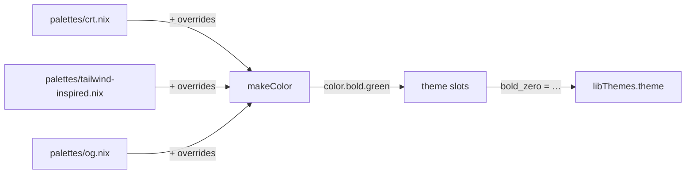

# lib/themes/palettes - Color Palette Data

Hex color definitions organized as named palette files. Each palette is a
Nix attrset mapping color names to `#RRGGBB` hex strings. Palettes are
immutable — they define base colors that themes consume. Themes that need
different values use the `overrides` field to patch individual colors
without modifying the palette file. Discovery accepts regular `.nix` files
only, and every value must match the exact `#RRGGBB` form.

Ref: https://www.figma.com/colors/

## What belongs here

- Palette `.nix` files that export a `name → "#hex"` attrset
- Each file is a self-contained immutable color set that `palette.nix`
  loads and converts into true-color escape codes

## What does not belong here

- Theme slot maps (those live in `../themes/`)
- Rendering logic or escape code generation (that lives in `../palette.nix`)
- Mode codes like reset or italic
- Color overrides (those live in theme files' `overrides` field)

## How palettes feed themes

Each theme declares which palette it uses (e.g. `palette = "crt"`) and
optionally overrides individual colors (e.g. `overrides = { blue = "#4488dd"; }`).
`palette.nix` loads the base palette, merges overrides, builds the `color`
attrset, and passes it to the theme's `slots` function.

## Adding a new palette

1. Create a `.nix` file here with a `name → "#hex"` attrset.
2. Reference it from a theme file's `palette` field (e.g. `palette = "my-palette"`).
3. Existing themes are unaffected — each theme declares its own palette.

## Available palettes

| Palette | Feel |
|---------|------|
| `crt` | Warm amber phosphor monitor aesthetic |
| `og` | Standard ANSI terminal colors (xterm-256color) |
| `tailwind-inspired` | Tailwind CSS default palette, neutral and readable |

## Slots assignment

  Slot | Color           | Role
  -----|----------------|-------------------------------------------
  0    | bold_zero      | Primary accent (success, headers, positive)
  1    | bold_one       | Text emphasis
  2    | bold_two       | Tertiary accent (e.g. NixOS section)
  3    | bold_three     | Callout / alternative highlight
  4    | bold_four      | Warning / highlight
  5    | bold_five      | Error / danger

  Non-bold slots follow the same numbering.
  Dimmed slots use dimmed yellow for accent, grey for muted text.

  Mode codes are theme-independent text attributes (defined in `palette.nix`):

  Attribute     | Code      | Role
  -------------|-----------|--------------------------------
  mode.reset   | `\e[0m`   | Reset all text attributes
  mode.italic  | `\e[3m`   | Italic text

## Where to look next

- `../palette.nix` — hex → RGB conversion, escape code rendering, theme discovery
- `../themes/` — slot maps that assign palette colors to numbered slots
