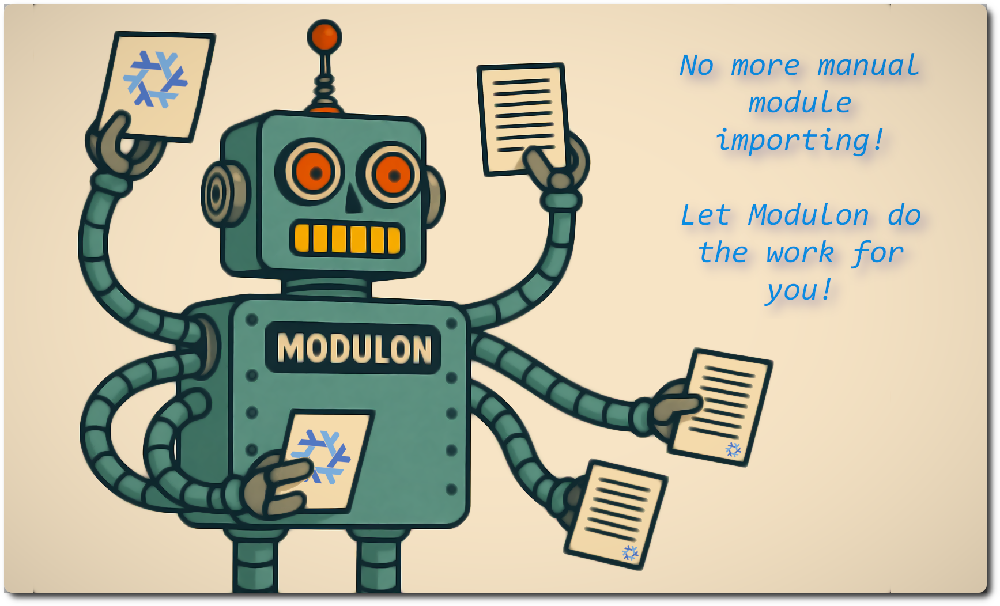

<p align="center" style="font-size: 1.5em;"><strong>Introducing Modulon 🦾</strong></p>

<p align="center"><em>Drop in a module. Let Modulon wire the import list.</em></p>

<p align="center">Works with NixOS • GNU/Linux distros & macOS via Home Manager</p>

<br>

## Why Modulon

Nix modules scale well, but import lists usually do not. Even today, many NixOS
and Home Manager configurations still rely on hand-maintained `imports = [ ... ]`
lists. Every new module needs a second edit somewhere else, and stale imports
become another piece of configuration drift.

Modulon removes that pain point. Point it at one or more directories and it
auto-discovers real Nix modules by reading file content, then returns a normal
`{ imports = [ ... ]; }` module. Add a module file and it is loaded. Add
`@MODULON_SKIP` when a file should stay nearby without being imported, such as a
data module, a helper module, or a module you want to keep parked for later.

## Quick Start

1. **Use the library function:**

```nix
let
  moduleImporter = inputs.nix-ignite.lib.modulon;
in {
  nixosConfigurations.myhost = nixpkgs.lib.nixosSystem {
    modules = [
      ./configuration.nix
      (moduleImporter { dirs = [ ./modules ]; })
    ];
  };
}
```

That's it. Modulon automatically discovers and imports valid NixOS, Home
Manager, and shared Nix modules from `./modules`.

<br>

## Table of Contents

- [How It Works](docs/01-HOW-IT-WORKS.md) — Module discovery process and pattern matching
- [Configuration](docs/02-CONFIGURATION.md) — Options reference and defaults
- [Excluding Modules](docs/03-EXCLUDING-MODULES.md) — `excludePaths` and `@MODULON_SKIP`
- [Extra Modules](docs/04-EXTRA-MODULES.md) — Include specific modules from excluded paths
- [Testing](docs/05-TESTING.md) — Running and debugging flake checks
- [Contributing](docs/06-CONTRIBUTING.md) — How to contribute

<br>

## License

Unless otherwise stated, everything in this repo is covered by the following copyright notice:

```plaintext
Modulon - An automated NixOS/Nix module importer.
Copyright (C) 2024-2026  Martín Cigorraga <cig0.github@gmail.com>

This program is free software: you can redistribute it and/or modify it
under the terms of the GNU Affero General Public License v3 or later, as
published by the Free Software Foundation.

This program is distributed in the hope that it will be useful,
but WITHOUT ANY WARRANTY; without even the implied warranty of
MERCHANTABILITY or FITNESS FOR A PARTICULAR PURPOSE.  See the
GNU General Public License for more details.

You should have received a copy of the GNU General Public License
along with this program.  If not, see <http://www.gnu.org/licenses/>.
```
