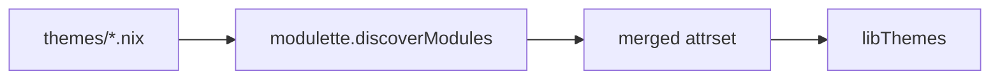

# Themes

ANSI escape code constants for terminal color output. Theme files are auto-discovered via Modulette — drop a `.nix` file with the required header and it becomes available.

## Architecture

Colors are decoupled from usage through **numbered semantic slots**:

1. **Palette** (`palette.nix`) — raw ANSI escape codes, referenced by color name.
2. **Theme** (`themes/*.nix`) — maps numbered slots to palette colors.
3. **Consuming code** — references only numbered slots (`bold_zero`, `bold_one`, …).

To switch themes, create a new `.nix` file that maps the same numbered slots to
different palette colors. No other files need to change.

To add a theme, create a new `.nix` file in `themes/` with the `# ANSI theme module.`
header.

### Slot assignments

| Slot         | Role                              |
|-------------|-----------------------------------|
| `bold_zero`  | Primary accent (success, headers) |
| `bold_one`   | Text emphasis                     |
| `bold_two`   | Tertiary accent                   |
| `bold_three` | Callout / alternative highlight   |
| `bold_four`  | Warning / highlight               |
| `bold_five`  | Error / danger                    |
| `zero`       | Non-bold primary accent           |
| `two`        | Non-bold callout                  |
| `four`       | Non-bold warning                  |

## Available themes

| Theme | Slot 0 | Slot 1 | Slot 2 | Slot 3 | Slot 4 | Slot 5 | Feel |
|-------|--------|--------|--------|--------|--------|--------|------|
| nushell-inspired | green | white | blue | magenta | yellow | red | Clean, default |
| catppuccin-mocha | magenta | white | cyan | blue | yellow | red | Soft pastels, Mauve accent |
| dracula | cyan | white | magenta | green | yellow | red | Dark purple, cyan accents |
| gruvbox-dark | yellow | white | cyan | green | magenta | red | Warm, retro, amber accent |
| nord | blue | white | cyan | magenta | yellow | red | Cold, icy blues |

To select a theme, set `myOptions.hm.data.theme.name` in your host config
(e.g. `"nushell-inspired"`, `"catppuccin-mocha"`, `"dracula"`,
`"gruvbox-dark"`, `"nord"`).

## Palette colors

| Name    | Bold        | Non-bold   |
|---------|-------------|------------|
| blue    | `\e[1;34m` | `\e[34m`  |
| cyan    | `\e[1;36m` | `\e[36m`  |
| green   | `\e[1;32m` | `\e[32m`  |
| magenta | `\e[1;35m` | `\e[35m`  |
| red     | `\e[1;31m` | `\e[31m`  |
| yellow  | `\e[1;33m` | `\e[33m`  |
| white   | `\e[1;97m` | `\e[97m`  |

## Shared exports

| Attribute     | Description                                      |
|---------------|--------------------------------------------------|
| `theme.*`     | Numbered slot constants (bold_zero, bold_one, …) |
| `mode.italic` | Italic text                                      |
| `mode.reset`  | Reset all text attributes                        |
| `select name` | Return one selected theme with `theme` and `mode` |
| `withoutAnsi libThemes` | Return the same theme shape with empty strings |
| `resolve { name, enableAnsi }` | Select a theme, or select its plain-text form |

## ANSI and plain rendering

Most consumers want ANSI escape codes. Runtime shell text that must render
before color support is useful, or that needs a debug-safe monochrome fallback,
should keep the same theme API and resolve a plain theme:

```nix
libThemes.resolve {
  name = config.myOptions.hm.data.theme.name;
  enableAnsi = anyShellEnabled;
}
```

When `enableAnsi = false`, every `theme.*` and `mode.*` value resolves to `""`.
Consumers can keep using explicit slots like `theme.bold_zero` and `mode.reset`
without branching around every decorated string.

## Usage

```nix
let c = libThemes;
in ''printf '%b' "\n${c.theme.bold_zero}Success${c.mode.reset}"''
```

## Auto-discovery



## Where to look next

- [Theme files](themes/README.md) - slot maps for each bundled theme
- [Modulette](../modulette/README.md) - header-validated data discovery used by themes
- [Modulon exclusions](../modulon/docs/03-EXCLUDING-MODULES.md) - when nearby `.nix` files should be skipped instead of discovered
