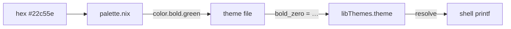
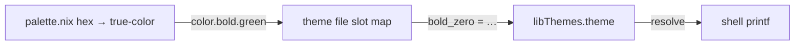
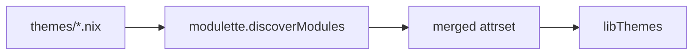

# Themes

True-color palette and slot-based theme system for terminal output. Colors are
defined as hex values in `palette.nix`, rendered as 24-bit true-color escape
codes, and mapped to semantic slots by theme files. Theme files are
auto-discovered via Modulette — drop a `.nix` file with the required header
and it becomes available.

## Quick start

### 1. Add the library to your flake

Add `nix-ignite` as a flake input. `flakeRoot` is baked in at the library
level, so `ignite.igniteLibs.themes` is ready to use — no manual `import`
needed:

```nix
# flake.nix
inputs = {
  nixpkgs.url = "github:NixOS/nixpkgs/nixos-unstable";
  ignite.url = "github:your-org/nix-ignite";
};

outputs = { nixpkgs, ignite, ... }:
let
  libThemes = ignite.igniteLibs.themes;
in
  # Pass libThemes to any module that needs colors
  { ... };
```

### 2. Resolve a theme for your host

`libThemes` ships every theme as a map. Before resolving,
`libThemes.theme` is a nested attrset — one entry per theme:

```nix
libThemes.theme.nushell-inspired.bold_zero  # "\e[1;38;2;34;197;94m"
libThemes.theme.dracula.bold_zero           # "\e[1;38;2;6;182;212m"
```

Most of the time you want **one** theme resolved for the current host, not the
whole map. `resolve` flattens `theme` into a single slot set and optionally
strips color codes:

```nix
let
  c = libThemes.resolve {
    name = "nushell-inspired";
    enableColors = true;
  };
in
```

`c` now holds:

| Attribute | Value |
|-----------|-------|
| `c.theme.bold_zero` | `\e[1;38;2;34;197;94m` (green) |
| `c.theme.bold_one` | `\e[1;38;2;248;250;252m` (white) |
| `c.theme.bold_four` | `\e[1;38;2;245;158;11m` (yellow) |
| `c.theme.bold_five` | `\e[1;38;2;239;68;68m` (red) |
| `c.mode.reset` | `\e[0m` |
| `c.mode.italic` | `\e[3m` |
| … | (all other slots) |

> **Don't skip `resolve`.** If you use `libThemes.theme.bold_zero` directly
> (without resolving), you'll get an attrset of theme maps — not a string.
> Always `resolve` first.

### 3. Use slots in shell output

```nix
let c = libThemes.resolve { name = "nushell-inspired"; enableColors = true; };
in ''
  printf '%b' "  ${c.theme.bold_zero}OK${c.mode.reset}   Package installed"
  printf '%b' "\n  ${c.theme.bold_four}WARN${c.mode.reset} Version outdated"
  printf '%b' "\n  ${c.theme.bold_five}ERR${c.mode.reset}  Build failed"
  printf '%b' "\n  ${c.theme.bold_two}Note${c.mode.reset} ${c.mode.italic}See docs${c.mode.reset} for details"
  printf '%b' "\n"
''
```

Renders in the terminal as:

```
  OK   Package installed        ← green
  WARN Version outdated          ← yellow
  ERR  Build failed             ← red
  Note See docs for details      ← blue + italic
```

### 4. Toggle colors off — same code, no conditionals

Set `enableColors = false` and every slot resolves to `""`. Same `printf`
calls, plain output, no branching:

```nix
let
  c = libThemes.resolve {
    name = "nushell-inspired";
    enableColors = false;   # ← only change
  };
in ''
  printf '%b' "  ${c.theme.bold_zero}OK${c.mode.reset}   Package installed"
  printf '%b' "\n  ${c.theme.bold_four}WARN${c.mode.reset} Version outdated"
  printf '%b' "\n  ${c.theme.bold_five}ERR${c.mode.reset}  Build failed"
  printf '%b' "\n  ${c.theme.bold_two}Note${c.mode.reset} ${c.mode.italic}See docs${c.mode.reset} for details"
  printf '%b' "\n"
''
```

Renders as:

```
  OK   Package installed
  WARN Version outdated
  ERR  Build failed
  Note See docs for details
```

No `if` statements. No color checks at every print call. The slots are either
true-color escape codes or empty strings — `printf '%b'` handles both. When
colors are disabled, all escape codes (including `mode.reset` and
`mode.italic`) become empty strings, so the terminal's own color palette flows
through untouched.

## Choosing a theme per host

In a Home Manager or NixOS setup, you typically declare a theme name once per
host and resolve it wherever colors are needed.

### Declare the option

`default.nix` already declares `myOptions.hm.data.theme.name` with
`"nushell-inspired"` as the default. Set it in your host config:

```nix
# hosts/my-laptop/default.nix
myOptions.hm.data.theme.name = "dracula";
```

### Resolve once, pass everywhere

Resolve the theme in the module that wires your shell commands, then pass the
resolved attrset downstream:

```nix
let
  anyShellEnabled =
    config.myOptions.hm.programs.bash.enable
    || config.myOptions.hm.programs.zsh.enable
    || config.myOptions.hm.programs.fish.enable;

  c = libThemes.resolve {
    name = config.myOptions.hm.data.theme.name;
    enableColors = anyShellEnabled;
  };
in
# Now pass `c` (or `libThemes = c`) to every module that prints colored output
```

Downstream modules just use `c.theme.bold_zero` and `c.mode.reset` — they
don't know or care which theme is active or whether colors are enabled.

### Pass libThemes into modules

In a NixOS + Home Manager setup, `libThemes` is wired through
`extraSpecialArgs` (NixOS) or `_module.args` (standalone HM). This is what
makes `libThemes` available as a function argument:

```nix
# NixOS — config/home-manager/home.nix
home-manager.extraSpecialArgs = {
  inherit libThemes;
};

# Standalone HM — flake.nix.d/builders.nix
_module.args = {
  inherit libThemes;
};
```

After that, any module can receive `libThemes` by listing it in its function
arguments.

### Consume in a shell module

```nix
# modules/homebrew.nix
{ libThemes, ... }:
let
  c = libThemes;  # already resolved upstream
in {
  programs.bash.initExtra = ''
    sync-brew() {
      printf '%b' "${c.theme.bold_zero}Synchronizing${c.mode.reset} Homebrew packages..."
      printf '%b' "\n"
      brew update
      printf '%b' "${c.theme.bold_zero}Done${c.mode.reset}"
      printf '%b' "\n"
    }
  '';
}
```

Switch the host's `theme.name` to `"311amber"` and every module picks up the
new palette — no other changes required.

## Architecture

Colors are decoupled from usage through three layers:

1. **Palette** (`palette.nix`) — hex color definitions (#RRGGBB),
   rendered to true-color escape codes (\e[38;2;R;G;Bm).
2. **Theme** (`themes/*.nix`) — maps numbered slots to palette colors.
3. **Consuming code** — references only numbered slots (`bold_zero`,
   `bold_one`, …).



To switch themes, create a new `.nix` file that maps the same numbered slots to
different palette colors. No other files need to change.

### Slot assignments

| Slot | Role |
|------|------|
| `bold_zero` | Primary accent (success, headers) |
| `bold_one` | Text emphasis |
| `bold_two` | Tertiary accent |
| `bold_three` | Callout / alternative highlight |
| `bold_four` | Warning / highlight |
| `bold_five` | Error / danger |
| `dimmed_zero` | Dimmed primary accent |
| `dimmed_one` | Dimmed text emphasis |
| `zero` | Non-bold primary accent |
| `two` | Non-bold callout |
| `four` | Non-bold warning |

### How slots flow to the terminal



Your code only references `theme.bold_zero`. Swap the theme file and the same
slot produces a different color — no consumer edits.

## Creating a custom theme

### Step 1: Pick a theme to copy

Look at `themes/nushell-inspired.nix` for the canonical example:

```nix
# Theme module. Do not remove this header.
{ color }:
{
  bold_zero  = color.bold.green;
  bold_one   = color.bold.white;
  bold_two   = color.bold.blue;
  bold_three = color.bold.magenta;
  bold_four  = color.bold.yellow;
  bold_five  = color.bold.red;
  dimmed_zero = color.dimmed.green;
  dimmed_one  = color.dimmed.white;
  zero  = color.green;
  one   = color.white;
  two   = color.blue;
  three = color.magenta;
  four  = color.yellow;
  five  = color.red;
}
```

Every theme receives `{ color }` from the palette and maps slots to `color.*`
names.

### Step 2: Create your theme file

Create a new `.nix` file in `themes/` with the required header. You only need
to define the slots you actually use — not every theme fills every slot:

```nix
# Theme module. Do not remove this header.
{ color }:
{
  bold_zero  = color.bold.cyan;
  bold_one   = color.bold.white;
  bold_two   = color.bold.magenta;
  bold_three = color.bold.green;
  bold_four  = color.bold.yellow;
  bold_five  = color.bold.red;
  zero  = color.cyan;
  two   = color.magenta;
  four  = color.yellow;
}
```

That's it. Modulette auto-discovers files in `themes/` with the
`# Theme module.` header — no registration, no imports to update.

Only define the slots your consumers reference. The bundled themes define bold
slots plus a few non-bold slots; `nushell-inspired` is the most complete and
also includes `dimmed_*`.

### Step 3: Use it

Set the theme name in your host config:

```nix
myOptions.hm.data.theme.name = "my-custom-theme";
```

The name is the filename without `.nix` — `my-custom-theme.nix` becomes
`"my-custom-theme"`.

### Step 4: Verify

If you set a name that doesn't match a theme file, `resolve` throws:

```
error: Unknown theme 'does-not-exist'. Available themes: 311amber, catppuccin-mocha, dracula, gruvbox-dark, my-custom-theme, nord, nushell-inspired
```

This lists every discovered theme, so you can spot typos immediately.

## Adding a new color to the palette

If none of the built-in colors fit your theme, add one to `palette.nix`.

### Step 1: Add the hex definition

Open `palette.nix` and add your color to the `hex` attrset. Bold and dimmed
variants are generated automatically — you only need the hex value:

```nix
hex = {
  # ...existing colors...
  orange = "#f97316";   # ← add the hex value
};
```

This immediately makes `color.orange`, `color.bold.orange`, and
`color.dimmed.orange` available to all themes.

### Step 2: Use it in a theme

Any theme file can now reference the new color:

```nix
# Theme module. Do not remove this header.
{ color }:
{
  bold_zero = color.bold.orange;   # ← uses the new color
  # ...
}
```

No other changes needed — the palette feeds all themes.

## Available themes

| Theme | Slot 0 | Slot 1 | Slot 2 | Slot 3 | Slot 4 | Slot 5 | Feel |
|-------|--------|--------|--------|--------|--------|--------|------|
| 311amber | green | white | yellow | yellow | dimmed yellow | red | Vintage phosphor CRT |
| catppuccin-mocha | magenta | white | cyan | blue | yellow | red | Soft pastels, Mauve accent |
| dracula | cyan | white | magenta | green | yellow | red | Dark purple, cyan accents |
| gruvbox-dark | yellow | white | cyan | green | magenta | red | Warm, retro, amber accent |
| nord | blue | white | cyan | magenta | yellow | red | Cold, icy blues |
| nushell-inspired | green | white | blue | magenta | yellow | red | Clean, default |

To select a theme, set `myOptions.hm.data.theme.name` in your host config
(e.g. `"311amber"`, `"catppuccin-mocha"`, `"dracula"`, `"gruvbox-dark"`,
`"nord"`, `"nushell-inspired"`).

## Palette colors

Each hex definition generates three foreground variants:

| Name | Hex | Bold | Regular | Dimmed |
|------|-----|------|---------|--------|
| blue | `#3b82f6` | `\e[1;38;2;59;130;246m` | `\e[38;2;59;130;246m` | computed |
| cyan | `#06b6d4` | `\e[1;38;2;6;182;212m` | `\e[38;2;6;182;212m` | computed |
| green | `#22c55e` | `\e[1;38;2;34;197;94m` | `\e[38;2;34;197;94m` | computed |
| grey | `#6b7280` | `\e[1;38;2;107;114;128m` | `\e[38;2;107;114;128m` | computed |
| magenta | `#d946ef` | `\e[1;38;2;217;70;239m` | `\e[38;2;217;70;239m` | computed |
| red | `#ef4444` | `\e[1;38;2;239;68;68m` | `\e[38;2;239;68;68m` | computed |
| white | `#f8fafc` | `\e[1;38;2;248;250;252m` | `\e[38;2;248;250;252m` | computed |
| yellow | `#f59e0b` | `\e[1;38;2;245;158;11m` | `\e[38;2;245;158;11m` | computed |

Dimmed variants use computed reduced-brightness RGB (`dimFactor = 0.55`)
instead of the faint SGR attribute (`\e[2`), which renders inconsistently
across terminals when combined with 24-bit color.

## Shared exports

| Attribute | Description |
|-----------|-------------|
| `theme.*` | Numbered slot constants (bold_zero, bold_one, …) |
| `mode.italic` | Italic text |
| `mode.reset` | Reset all text attributes |
| `select name` | Return one theme as `{ theme, mode }` — use when you need a specific theme without the color toggle |
| `withoutColors libThemes` | Replace every slot with `""` — used internally by `resolve`, rarely called directly |
| `resolve { name, enableColors }` | Select a theme and optionally strip color codes — the function most consumers should use |

## Color rendering

Most consumers want true-color escape codes. Runtime shell text that must render
before color support is useful, or that needs a debug-safe plain fallback,
should keep the same theme API and resolve a plain theme:

```nix
libThemes.resolve {
  name = config.myOptions.hm.data.theme.name;
  enableColors = anyShellEnabled;
}
```

When `enableColors = false`, every `theme.*` and `mode.*` value resolves to
`""`. Consumers can keep using explicit slots like `theme.bold_zero` and
`mode.reset` without branching around every decorated string. The terminal's
own color palette flows through untouched — no monochrome override.

## Auto-discovery



## Where to look next

- [Theme files](themes/README.md) - slot maps for each bundled theme
- [Modulette](../modulette/README.md) - header-validated data discovery used by themes
- [Modulon exclusions](../modulon/docs/03-EXCLUDING-MODULES.md) - when nearby `.nix` files should be skipped instead of discovered
- [help-legend renderers](../decorators/help-legend/renderers/README.md) - shell-native output that pairs well with themed colors