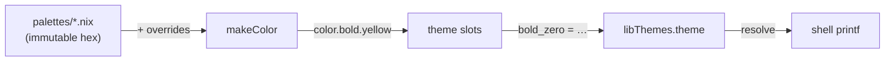

# Themes

True-color palette and slot-based theme system for terminal output. Colors are
defined as hex values in palette files, rendered as 24-bit true-color escape
codes, and mapped to semantic slots by theme files. Each theme declares which
palette it consumes and may override individual colors. Theme files are
auto-discovered via Modulette — drop a `.nix` file with the required header
and it becomes available.

## Architecture

Colors are decoupled from usage through three layers:

1. **Palette** (`palettes/*.nix`) — immutable hex color definitions (#RRGGBB).
   Palettes define base colors that themes consume.
2. **Theme** (`themes/*.nix`) — declares which palette to consume, optional
   color overrides and `dimFactor`, and maps numbered slots to palette colors.
3. **Consuming code** — references only numbered slots (`bold_zero`,
   `bold_one`, …).



Your code only references `theme.bold_zero`. Swap the theme file and the same
slot produces a different color — no consumer edits.

### Palette resolution per theme

Each theme resolves its palette independently:

1. Theme declares `palette = "crt"` (or `"tailwind-inspired"`, `"og"`, etc.)
2. `palette.nix` loads the palette hex values from `palettes/<name>.nix`
3. Theme's `overrides` (if any) are merged: `hex = basePalette // overrides`
4. The merged hex is converted to `color.*` escape codes
5. The `color` attrset is passed to the theme's `slots` function

### Slot assignments

Every theme maps the same semantic slots to different palette colors. The slot
role is fixed — only the color changes between themes.

| Slot | Role |
|------|------|
| `bold_zero` | Primary accent (success, headers, positive) |
| `bold_one` | Text emphasis |
| `bold_two` | Tertiary accent (e.g. NixOS section) |
| `bold_three` | Callout / alternative highlight |
| `bold_four` | Warning / highlight |
| `bold_five` | Error / danger |
| `dimmed_zero` | Dimmed primary accent |
| `dimmed_one` | Dimmed text emphasis |
| `zero` | Non-bold primary accent |
| `one` | Non-bold text emphasis |
| `two` | Non-bold tertiary accent |
| `three` | Non-bold callout |
| `four` | Non-bold warning |
| `five` | Non-bold error |

Mode codes are theme-independent text attributes (defined in `palette.nix`):

| Attribute | Code | Role |
|-----------|------|------|
| `mode.reset` | `\e[0m` | Reset all text attributes |
| `mode.italic` | `\e[3m` | Italic text |

## Quick start

### Add the library to your flake

```nix
# flake.nix
inputs = {
  nixpkgs.url = "github:NixOS/nixpkgs/nixos-unstable";
  fuel.url = "github:your-org/nix-fuel";
};

outputs = { nixpkgs, fuel, ... }:
let
  libThemes = fuel.fuelLibs.themes;
in
  { ... };
```

`flakeRoot` is baked in — `fuel.fuelLibs.themes` is ready to use.

### Resolve a theme for your host

`libThemes.theme` is a nested attrset (one entry per theme). Most of the time
you want **one** theme resolved for the current host. `resolve` flattens it
into a single slot set and optionally strips color codes:

```nix
let
  c = libThemes.resolve {
    name = "nushell-inspired";
    enableColors = true;
  };
in ''
  printf '%b' "  ${c.theme.bold_zero}OK${c.mode.reset}   Package installed"
  printf '%b' "\n  ${c.theme.bold_four}WARN${c.mode.reset} Version outdated"
  printf '%b' "\n  ${c.theme.bold_five}ERR${c.mode.reset}  Build failed"
  printf '%b' "\n"
''
```

When `enableColors = false`, every slot resolves to `""` — same `printf`
calls, plain output, no branching. `mode.reset` and `mode.italic` also become
empty strings, so the terminal's own color palette flows through untouched.

> **Don't skip `resolve`.** Using `libThemes.theme.bold_zero` directly returns an
> attrset of theme maps — not a string. Always `resolve` first.

## Integration

In a NixOS + Home Manager setup, declare the theme per host in `profile.nix`:

```nix
# hosts/my-laptop/profile.nix
myOptions.hm.data.theme = {
  enableColors = true;
  name = "311amber";
};
```

`enableColors` → `true` emits real terminal colors, `false` strips all color
codes. `null` (the default) enables colors when at least one shell program is
active for the host.

Resolve once and pass downstream — modules don't need to know which theme is
active or how colors were toggled:

```nix
let
  c = libThemes.resolve {
    name = config.myOptions.hm.data.theme.name;
    # → enableColors: explicit override from profile, or auto-detect from shell enablement
    enableColors =
      let ec = config.myOptions.hm.data.theme.enableColors;
      in if ec != null then ec else anyShellEnabled;
  };
in
# Pass `c` (or `libThemes = c`) to every module that prints colored output
```

Wire `libThemes` through `extraSpecialArgs` (NixOS) or `_module.args` (standalone
HM). Downstream modules receive it as a function argument:

```nix
# NixOS — config/home-manager/home.nix
home-manager.extraSpecialArgs = { inherit libThemes; };

# Standalone HM — flake.nix.d/builders.nix
_module.args = { inherit libThemes; };
```

## Theme format

Every theme file declares four fields:

| Field | Required | Description |
|-------|----------|-------------|
| `palette` | yes | Palette file name in `palettes/` (without `.nix`) |
| `overrides` | no | `{ name = "#hex"; }` patches to palette colors (default: `{ }`) |
| `dimFactor` | no | Dimming intensity for `color.dimmed.*` (default: `0.55`, lower = dimmer) |
| `slots` | yes | Function from `{ color }` to the slot attrset |

Overrides replace or add palette colors for a single theme — all variants
(`color.bold.<name>`, `color.<name>`, `color.dimmed.<name>`) derive from the
patched hex. Other themes using the same palette are unaffected.

```nix
# Theme module. Do not remove this header.
# Steel — Tailwind palette with a muted blue override
{ }:
{
  palette = "tailwind-inspired";
  overrides = { blue = "#4a6fa5"; };
  dimFactor = 0.4;   # lower = dimmer (default: 0.55)
  slots = { color }:
  {
    bold_zero = color.bold.blue;    # ← #4a6fa5, not the palette's #3b82f6
    bold_one  = color.bold.white;
    # ...
  };
}
```

See [theme files](themes/README.md) for the full format and override examples.
To add a new palette, see [palette files](palettes/README.md).

## Available themes

| Theme | Palette | Slot 0 | Slot 1 | Slot 2 | Slot 3 | Slot 4 | Slot 5 | Feel |
|-------|---------|--------|--------|--------|--------|--------|--------|------|
| 311amber | crt | orange | white | blue | magenta | yellow | red | Vintage phosphor CRT |
| catppuccin-mocha | tailwind-inspired | magenta | white | cyan | blue | yellow | red | Soft pastels, Mauve accent |
| dracula | tailwind-inspired | cyan | white | magenta | green | yellow | red | Dark purple, cyan accents |
| gruvbox-dark | tailwind-inspired | yellow | white | cyan | green | magenta | red | Warm, retro, amber accent |
| nord | tailwind-inspired | blue | white | cyan | magenta | yellow | red | Cold, icy blues |
| nushell-inspired | og | green | white | blue | magenta | yellow | red | ANSI terminal colors |
| steel | tailwind-inspired + overrides | blue | white | cyan | magenta | yellow | red | Muted steel blue accent |

Set `myOptions.hm.data.theme.name` and `myOptions.hm.data.theme.enableColors`
in your host's `profile.nix`. The name is the filename without `.nix`;
`enableColors` defaults to `null` (auto-detect from shell enablement).

If the name doesn't match a theme file, `resolve` throws with a list of
available themes. If a theme references a nonexistent palette, `palette.nix`
throws with a list of available palettes.

## Available palettes

| Palette | Feel |
|---------|------|
| `crt` | Warm amber phosphor monitor aesthetic — shifted blues/magentas |
| `og` | Standard ANSI terminal colors (xterm-256color) |
| `tailwind-inspired` | Tailwind CSS default palette, neutral and readable |

Each palette is a `name → "#RRGGBB"` attrset. Themes consume palettes via the
`palette` field and may override individual colors via `overrides`.

## Palette colors

### crt

| Name | Hex | Description |
|------|-----|-------------|
| blue | `#5b8dd9` | Warmer blue for dark backgrounds |
| cyan | `#00b8b8` | Teal-shifted cyan |
| green | `#22c55e` | Standard green |
| grey | `#aaaaaa` | Light grey for dimmed text |
| magenta | `#cc66cc` | Warmer magenta |
| orange | `#ffb343` | Amber orange |
| red | `#ef4444` | Standard red |
| white | `#f8fafc` | Near-white |
| yellow | `#ffed29` | Bright yolk yellow |

### og

| Name | Hex | ANSI code | Description |
|------|-----|-----------|-------------|
| blue | `#0000ee` | 34 | Standard ANSI blue |
| cyan | `#00cdcd` | 36 | Standard ANSI cyan |
| green | `#00cd00` | 32 | Standard ANSI green |
| grey | `#767676` | — | Terminal grey |
| magenta | `#cd00cd` | 35 | Standard ANSI magenta |
| orange | `#ff6600` | — | Vivid orange (compat) |
| red | `#cd0000` | 31 | Standard ANSI red |
| white | `#ffffff` | 97 | Bright white |
| yellow | `#cdcd00` | 33 | Standard ANSI yellow |

### tailwind-inspired

| Name | Hex | Description |
|------|-----|-------------|
| blue | `#3b82f6` | Tailwind blue-500 |
| cyan | `#06b6d4` | Tailwind cyan-500 |
| green | `#22c55e` | Tailwind green-500 |
| grey | `#9ca3af` | Tailwind gray-400 |
| magenta | `#d946ef` | Tailwind fuchsia-500 |
| orange | `#ff6600` | Vivid orange |
| red | `#ef4444` | Tailwind red-500 |
| white | `#f8fafc` | Tailwind slate-50 |
| yellow | `#f59e0b` | Tailwind amber-500 |

Each hex definition generates three foreground variants:

| Variant | Format | Example (green `#22c55e`) |
|---------|--------|---------------------------|
| Regular | `\e[38;2;R;G;Bm` | `\e[38;2;34;197;94m` |
| Bold | `\e[1;38;2;R;G;Bm` | `\e[1;38;2;34;197;94m` |
| Dimmed | computed RGB (dimFactor = 0.55) | `\e[38;2;18;108;51m` |

Dimmed variants use computed reduced-brightness RGB instead of the faint SGR
attribute (`\e[2`), which renders inconsistently across terminals when combined
with 24-bit color.

## API

| Attribute | Description |
|-----------|-------------|
| `theme.*` | Numbered slot constants per theme (bold_zero, bold_one, …) |
| `mode.italic` | Italic text |
| `mode.reset` | Reset all text attributes |
| `select name` | Return one theme as `{ theme, mode }` — use when you need a specific theme without the color toggle |
| `withoutColors libThemes` | Replace every slot with `""` — used internally by `resolve`, rarely called directly |
| `resolve { name, enableColors }` | Select a theme and optionally strip color codes — the function most consumers should use |

## Where to look next

- [Palette files](palettes/README.md) — hex color definitions, how palettes feed themes, adding palettes
- [Theme files](themes/README.md) — slot maps, overrides, dimFactor, creating themes
- [Modulette](../modulette/README.md) — header-validated data discovery used by themes
- [Modulon exclusions](../modulon/docs/03-EXCLUDING-MODULES.md) — when nearby `.nix` files should be skipped
- [help-legend renderers](../decorators/help-legend/renderers/README.md) — shell-native output that pairs well with themed colors
