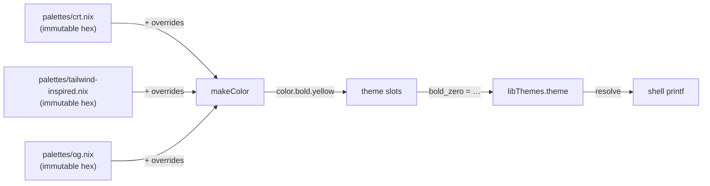
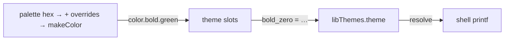
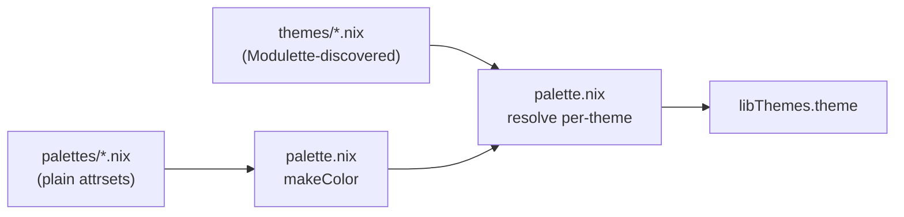

# Themes

True-color palette and slot-based theme system for terminal output. Colors are
defined as hex values in palette files, rendered as 24-bit true-color escape
codes, and mapped to semantic slots by theme files. Each theme declares which
palette it consumes and may override individual palette colors. Theme files are
auto-discovered via Modulette — drop a `.nix` file with the required header
and it becomes available.

## Architecture

Colors are decoupled from usage through three layers:

1. **Palette** (`palettes/*.nix`) — immutable hex color definitions (#RRGGBB),
   organized as named palette files. Palettes define base colors that themes
   consume.
2. **Theme** (`themes/*.nix`) — declares which palette to consume, optional
   color overrides, and maps numbered slots to palette colors.
3. **Consuming code** — references only numbered slots (`bold_zero`,
   `bold_one`, …).



Palettes are immutable — themes that need different values use the `overrides`
field to patch individual colors without modifying the palette file.

### Palette resolution per theme

Each theme resolves its palette independently:

1. Theme declares `palette = "crt"` (or `"tailwind-inspired"`, `"og"`, etc.)
2. `palette.nix` loads the palette hex values from `palettes/<name>.nix`
3. Theme's `overrides` (if any) are merged: `hex = basePalette // overrides`
4. The merged hex is converted to `color.*` escape codes
5. The `color` attrset is passed to the theme's `slots` function

To switch themes, create a new `.nix` file that maps the same numbered slots to
different palette colors. No other files need to change.

### Slot assignments

Every theme maps the same semantic slots to different palette colors. The slot
role is fixed — only the color changes between themes.

| Slot | Role |
|------|------|
| `bold_zero` | Primary accent (success, headers, positive) |
| `bold_one` | Text emphasis |
| `bold_two` | Tertiary accent (e.g. NixOS section) |
| `bold_three` | Callout / alternative highlight |
| `bold_four` | Warning / highlight |
| `bold_five` | Error / danger |
| `dimmed_zero` | Dimmed primary accent |
| `dimmed_one` | Dimmed text emphasis |
| `zero` | Non-bold primary accent |
| `one` | Non-bold text emphasis |
| `two` | Non-bold tertiary accent |
| `three` | Non-bold callout |
| `four` | Non-bold warning |
| `five` | Non-bold error |

### How slots flow to the terminal



Your code only references `theme.bold_zero`. Swap the theme file and the same
slot produces a different color — no consumer edits.

## Quick start

### 1. Add the library to your flake

Add `nix-ignite` as a flake input. `flakeRoot` is baked in at the library
level, so `ignite.igniteLibs.themes` is ready to use — no manual `import`
needed:

```nix
# flake.nix
inputs = {
  nixpkgs.url = "github:NixOS/nixpkgs/nixos-unstable";
  ignite.url = "github:your-org/nix-ignite";
};

outputs = { nixpkgs, ignite, ... }:
let
  libThemes = ignite.igniteLibs.themes;
in
  # Pass libThemes to any module that needs colors
  { ... };
```

### 2. Resolve a theme for your host

`libThemes` ships every theme as a map. Before resolving,
`libThemes.theme` is a nested attrset — one entry per theme:

```nix
libThemes.theme.nushell-inspired.bold_zero  # "\e[1;38;2;0;205;0m"
libThemes.theme.dracula.bold_zero           # "\e[1;38;2;6;182;212m"
```

Most of the time you want **one** theme resolved for the current host, not the
whole map. `resolve` flattens `theme` into a single slot set and optionally
strips color codes:

```nix
let
  c = libThemes.resolve {
    name = "nushell-inspired";
    enableColors = true;
  };
in
```

`c` now holds:

| Attribute | Value |
|-----------|-------|
| `c.theme.bold_zero` | `\e[1;38;2;0;205;0m` (green) |
| `c.theme.bold_one` | `\e[1;38;2;255;255;255m` (white) |
| `c.theme.bold_four` | `\e[1;38;2;205;205;0m` (yellow) |
| `c.theme.bold_five` | `\e[1;38;2;205;0;0m` (red) |
| `c.mode.reset` | `\e[0m` |
| `c.mode.italic` | `\e[3m` |
| … | (all other slots) |

> **Don't skip `resolve`.** If you use `libThemes.theme.bold_zero` directly
> (without resolving), you'll get an attrset of theme maps — not a string.
> Always `resolve` first.

### 3. Use slots in shell output

```nix
let c = libThemes.resolve { name = "nushell-inspired"; enableColors = true; };
in ''
  printf '%b' "  ${c.theme.bold_zero}OK${c.mode.reset}   Package installed"
  printf '%b' "\n  ${c.theme.bold_four}WARN${c.mode.reset} Version outdated"
  printf '%b' "\n  ${c.theme.bold_five}ERR${c.mode.reset}  Build failed"
  printf '%b' "\n  ${c.theme.bold_two}Note${c.mode.reset} ${c.mode.italic}See docs${c.mode.reset} for details"
  printf '%b' "\n"
''
```

### 4. Toggle colors off — same code, no conditionals

Set `enableColors = false` and every slot resolves to `""`. Same `printf`
calls, plain output, no branching:

```nix
let
  c = libThemes.resolve {
    name = "nushell-inspired";
    enableColors = false;   # ← only change
  };
in ''
  printf '%b' "  ${c.theme.bold_zero}OK${c.mode.reset}   Package installed"
  printf '%b' "\n  ${c.theme.bold_four}WARN${c.mode.reset} Version outdated"
  printf '%b' "\n  ${c.theme.bold_five}ERR${c.mode.reset}  Build failed"
  printf '%b' "\n  ${c.theme.bold_two}Note${c.mode.reset} ${c.mode.italic}See docs${c.mode.reset} for details"
  printf '%b' "\n"
''
```

No `if` statements. No color checks at every print call. The slots are either
true-color escape codes or empty strings — `printf '%b'` handles both. When
colors are disabled, all escape codes (including `mode.reset` and
`mode.italic`) become empty strings, so the terminal's own color palette flows
through untouched.

## Choosing a theme per host

In a Home Manager or NixOS setup, you typically declare a theme name once per
host and resolve it wherever colors are needed.

### Declare the option

`default.nix` already declares `myOptions.hm.data.theme.name` with
`"nushell-inspired"` as the default. Set it in your host config:

```nix
# hosts/my-laptop/default.nix
myOptions.hm.data.theme.name = "311amber";
```

### Resolve once, pass everywhere

Resolve the theme in the module that wires your shell commands, then pass the
resolved attrset downstream:

```nix
let
  anyShellEnabled =
    config.myOptions.hm.programs.bash.enable
    || config.myOptions.hm.programs.zsh.enable
    || config.myOptions.hm.programs.fish.enable;

  c = libThemes.resolve {
    name = config.myOptions.hm.data.theme.name;
    enableColors = anyShellEnabled;
  };
in
# Now pass `c` (or `libThemes = c`) to every module that prints colored output
```

Downstream modules just use `c.theme.bold_zero` and `c.mode.reset` — they
don't know or care which theme is active or whether colors are enabled.

### Pass libThemes into modules

In a NixOS + Home Manager setup, `libThemes` is wired through
`extraSpecialArgs` (NixOS) or `_module.args` (standalone HM). This is what
makes `libThemes` available as a function argument:

```nix
# NixOS — config/home-manager/home.nix
home-manager.extraSpecialArgs = {
  inherit libThemes;
};

# Standalone HM — flake.nix.d/builders.nix
_module.args = {
  inherit libThemes;
};
```

After that, any module can receive `libThemes` by listing it in its function
arguments.

### Consume in a shell module

```nix
# modules/homebrew.nix
{ libThemes, ... }:
let
  c = libThemes;  # already resolved upstream
in {
  programs.bash.initExtra = ''
    sync-brew() {
      printf '%b' "${c.theme.bold_zero}Synchronizing${c.mode.reset} Homebrew packages..."
      printf '%b' "\n"
      brew update
      printf '%b' "${c.theme.bold_zero}Done${c.mode.reset}"
      printf '%b' "\n"
    }
  '';
}
```

Switch the host's `theme.name` to `"311amber"` and every module picks up the
CRT palette — no other changes required.

## Creating a custom theme

### Step 1: Pick a palette and a theme to copy

Look at `palettes/` for available palettes and `themes/nushell-inspired.nix`
for the canonical theme example:

```nix
# Theme module. Do not remove this header.
{ }:
{
  palette = "og";
  slots = { color }:
  {
    bold_zero  = color.bold.green;
    bold_one   = color.bold.white;
    bold_two   = color.bold.blue;
    bold_three = color.bold.magenta;
    bold_four  = color.bold.yellow;
    bold_five  = color.bold.red;
    dimmed_zero = color.dimmed.green;
    dimmed_one  = color.dimmed.white;
    zero  = color.green;
    one   = color.white;
    two   = color.blue;
    three = color.magenta;
    four  = color.yellow;
    five  = color.red;
  };
}
```

Every theme declares:
- **`palette`** — which palette file in `palettes/` to consume
- **`overrides`** — optional `name → "#hex"` patches to the palette colors
- **`slots`** — function from `{ color }` to the slot attrset

### Step 2: Create your theme file

Create a new `.nix` file in `themes/` with the required header. You only need
to define the slots you actually use — not every theme fills every slot:

```nix
# Theme module. Do not remove this header.
{ }:
{
  palette = "tailwind-inspired";
  slots = { color }:
  {
    bold_zero  = color.bold.cyan;
    bold_one   = color.bold.white;
    bold_two   = color.bold.magenta;
    bold_three = color.bold.green;
    bold_four  = color.bold.yellow;
    bold_five  = color.bold.red;
    zero  = color.cyan;
    two   = color.magenta;
    four  = color.yellow;
  };
}
```

That's it. Modulette auto-discovers files in `themes/` with the
`# Theme module.` header — no registration, no imports to update.

### Step 3: Use overrides to customize palette colors

If your theme needs a color that doesn't exist in any palette, or needs a
different shade of an existing color, use `overrides` instead of modifying
the palette file (palettes are immutable):

```nix
# Theme module. Do not remove this header.
# Steel — Tailwind palette with a muted blue override
{ }:
{
  palette = "tailwind-inspired";
  overrides = { blue = "#4a6fa5"; };
  slots = { color }:
  {
    bold_zero = color.bold.blue;    # ← #4a6fa5, not the palette's #3b82f6
    bold_one  = color.bold.white;
    # ...
  };
}
```

Patched hex flows into `color.*` automatically — `color.bold.blue`,
`color.blue`, and `color.dimmed.blue` all derive from the overridden
`#4a6fa5`. Overrides can replace existing palette colors **or add new ones**.
If a theme needs a color that doesn't exist in its chosen palette, add it
via overrides rather than modifying the palette file.

Overrides only affect the theme declaring them. Other themes using the same
palette are unaffected — palettes are immutable.

### Step 4: Use it

Set the theme name in your host config:

```nix
myOptions.hm.data.theme.name = "my-custom-theme";
```

The name is the filename without `.nix` — `my-custom-theme.nix` becomes
`"my-custom-theme"`.

### Step 5: Verify

If you set a name that doesn't match a theme file, `resolve` throws:

```
error: Unknown theme 'does-not-exist'. Available themes: 311amber, catppuccin-mocha, dracula, gruvbox-dark, my-custom-theme, nord, nushell-inspired
```

This lists every discovered theme, so you can spot typos immediately.

If you reference a palette that doesn't exist, `palette.nix` throws:

```
error: Unknown palette 'nonexistent' for theme 'my-theme'. Available palettes: crt, og, tailwind-inspired
```

## Adding a new color to the palette

If none of the built-in colors fit your theme, add one to a palette file.

### Step 1: Add the hex definition

Open the relevant palette file in `palettes/` and add your color. Bold and
dimmed variants are generated automatically — you only need the hex value:

```nix
# In palettes/tailwind-inspired.nix
{
  # ...existing colors...
  purple = "#9333ea";   # ← add the hex value
}
```

This immediately makes `color.purple`, `color.bold.purple`, and
`color.dimmed.purple` available to themes that consume this palette.

### Step 2: Use it in a theme

Any theme consuming this palette can now reference the new color:

```nix
# Theme module. Do not remove this header.
{ }:
{
  palette = "tailwind-inspired";
  slots = { color }:
  {
    bold_zero = color.bold.purple;   # ← uses the new color
    # ...
  };
}
```

No other changes needed — the palette feeds all themes that consume it.

Or, if only one theme needs the color, use an override instead of modifying the
palette file:

```nix
# Theme module. Do not remove this header.
{ }:
{
  palette = "tailwind-inspired";
  overrides = { purple = "#9333ea"; };
  slots = { color }:
  {
    bold_zero = color.bold.purple;   # ← available via override
    # ...
  };
}
```

## Adding a new palette

1. Create a `.nix` file in `palettes/` with a `name → "#hex"` attrset.
2. Reference it from a theme file's `palette` field (e.g. `palette = "my-palette"`).
3. Existing themes are unaffected — each theme declares its own palette.

## Available themes

| Theme | Palette | Slot 0 | Slot 1 | Slot 2 | Slot 3 | Slot 4 | Slot 5 | Feel |
|-------|---------|--------|--------|--------|--------|--------|--------|------|
| 311amber | crt | orange | white | blue | magenta | yellow | red | Vintage phosphor CRT |
| catppuccin-mocha | tailwind-inspired | magenta | white | cyan | blue | yellow | red | Soft pastels, Mauve accent |
| dracula | tailwind-inspired | cyan | white | magenta | green | yellow | red | Dark purple, cyan accents |
| gruvbox-dark | tailwind-inspired | yellow | white | cyan | green | magenta | red | Warm, retro, amber accent |
| nord | tailwind-inspired | blue | white | cyan | magenta | yellow | red | Cold, icy blues |
| nushell-inspired | og | green | white | blue | magenta | yellow | red | ANSI terminal colors |
| steel | tailwind-inspired + overrides | blue | white | cyan | magenta | yellow | red | Muted steel blue accent |

To select a theme, set `myOptions.hm.data.theme.name` in your host config
(e.g. `"311amber"`, `"catppuccin-mocha"`, `"dracula"`, `"gruvbox-dark"`,
`"nord"`, `"nushell-inspired"`, `"steel"`).

## Available palettes

| Palette | Feel |
|---------|------|
| `crt` | Warm amber phosphor monitor aesthetic — shifted blues/magentas |
| `og` | Standard ANSI terminal colors (xterm-256color) |
| `tailwind-inspired` | Tailwind CSS default palette, neutral and readable |

Each palette is a `name → "#RRGGBB"` attrset. Themes consume palettes via the
`palette` field and may override individual colors via `overrides`.

## Palette colors

### crt

| Name | Hex | Description |
|------|-----|-------------|
| blue | `#5b8dd9` | Warmer blue for dark backgrounds |
| cyan | `#00b8b8` | Teal-shifted cyan |
| green | `#22c55e` | Standard green |
| grey | `#aaaaaa` | Light grey for dimmed text |
| magenta | `#cc66cc` | Warmer magenta |
| orange | `#ffb343` | Amber orange |
| red | `#ef4444` | Standard red |
| white | `#f8fafc` | Near-white |
| yellow | `#ffed29` | Bright yolk yellow |

### og

| Name | Hex | ANSI code | Description |
|------|-----|-----------|-------------|
| blue | `#0000ee` | 34 | Standard ANSI blue |
| cyan | `#00cdcd` | 36 | Standard ANSI cyan |
| green | `#00cd00` | 32 | Standard ANSI green |
| grey | `#767676` | — | Terminal grey |
| magenta | `#cd00cd` | 35 | Standard ANSI magenta |
| orange | `#ff6600` | — | Vivid orange (compat) |
| red | `#cd0000` | 31 | Standard ANSI red |
| white | `#ffffff` | 97 | Bright white |
| yellow | `#cdcd00` | 33 | Standard ANSI yellow |

### tailwind-inspired

| Name | Hex | Description |
|------|-----|-------------|
| blue | `#3b82f6` | Tailwind blue-500 |
| cyan | `#06b6d4` | Tailwind cyan-500 |
| green | `#22c55e` | Tailwind green-500 |
| grey | `#9ca3af` | Tailwind gray-400 |
| magenta | `#d946ef` | Tailwind fuchsia-500 |
| orange | `#ff6600` | Vivid orange |
| red | `#ef4444` | Tailwind red-500 |
| white | `#f8fafc` | Tailwind slate-50 |
| yellow | `#f59e0b` | Tailwind amber-500 |

Each hex definition generates three foreground variants:

| Variant | Format | Example (green `#22c55e`) |
|---------|--------|---------------------------|
| Regular | `\e[38;2;R;G;Bm` | `\e[38;2;34;197;94m` |
| Bold | `\e[1;38;2;R;G;Bm` | `\e[1;38;2;34;197;94m` |
| Dimmed | computed RGB (dimFactor = 0.55) | `\e[38;2;18;108;51m` |

Dimmed variants use computed reduced-brightness RGB instead of the faint SGR
attribute (`\e[2`), which renders inconsistently across terminals when combined
with 24-bit color.

## Shared exports

| Attribute | Description |
|-----------|-------------|
| `theme.*` | Numbered slot constants per theme (bold_zero, bold_one, …) |
| `mode.italic` | Italic text |
| `mode.reset` | Reset all text attributes |
| `select name` | Return one theme as `{ theme, mode }` — use when you need a specific theme without the color toggle |
| `withoutColors libThemes` | Replace every slot with `""` — used internally by `resolve`, rarely called directly |
| `resolve { name, enableColors }` | Select a theme and optionally strip color codes — the function most consumers should use |

## Color rendering

Most consumers want true-color escape codes. Runtime shell text that must render
before color support is useful, or that needs a debug-safe plain fallback,
should keep the same theme API and resolve a plain theme:

```nix
libThemes.resolve {
  name = config.myOptions.hm.data.theme.name;
  enableColors = anyShellEnabled;
}
```

When `enableColors = false`, every `theme.*` and `mode.*` value resolves to
`""`. Consumers can keep using explicit slots like `theme.bold_zero` and
`mode.reset` without branching around every decorated string. The terminal's
own color palette flows through untouched — no monochrome override.

## Auto-discovery



Palette files are plain attrsets auto-loaded from `palettes/`. Theme files are
discovered by Modulette via the `# Theme module.` header prefix. Each theme
declares which palette it consumes — `palette.nix` resolves colors independently
per theme.

## Where to look next

- [Palette files](palettes/README.md) - hex color definitions and how to add palettes
- [Theme files](themes/README.md) - slot maps, overrides, and how to create themes
- [Modulette](../modulette/README.md) - header-validated data discovery used by themes
- [Modulon exclusions](../modulon/docs/03-EXCLUDING-MODULES.md) - when nearby `.nix` files should be skipped instead of discovered
- [help-legend renderers](../decorators/help-legend/renderers/README.md) - shell-native output that pairs well with themed colors