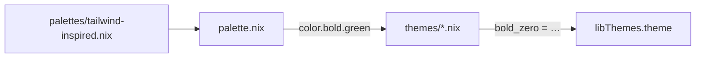

# lib/themes/palettes - Color Palette Data

Hex color definitions organized as named palette files. Each palette is a
Nix attrset mapping color names to `#RRGGBB` hex strings.

## What belongs here

- Palette `.nix` files that export a `name → "#hex"` attrset
- Each file is a self-contained color set that `palette.nix` loads and
  converts into true-color escape codes

## What does not belong here

- Theme slot maps (those live in `../themes/`)
- Rendering logic or escape code generation (that lives in `../palette.nix`)
- Mode codes like reset or italic

## How palettes feed themes

`palette.nix` imports a palette file, converts hex to RGB, and generates
`color.*`, `color.bold.*`, and `color.dimmed.*` escape codes. Theme files
consume these color names — they never reference hex values directly.

## Adding a new palette

1. Create a `.nix` file here with a `name → "#hex"` attrset.
2. Update `palette.nix` to point `paletteFile` at the new file (or add a
   palette selection mechanism).
3. Existing themes automatically pick up the new colors by name. New color
   names become available in all theme files.

## Slots assignment

  Slot | Color           | Role
  -----|----------------|-------------------------------------------
  0    | bold_zero      | Primary accent (success, headers, positive)
  1    | bold_one       | Text emphasis
  2    | bold_two       | Tertiary accent (e.g. NixOS section)
  3    | bold_three     | Callout / alternative highlight
  4    | bold_four      | Warning / highlight
  5    | bold_five      | Error / danger

  Non-bold slots follow the same numbering.
  Dimmed slots use dimmed yellow for accent, grey for muted text.

  Mode codes are theme-independent text attributes (defined in `palette.nix`):

  Attribute     | Code      | Role
  -------------|-----------|--------------------------------
  mode.reset   | `\e[0m`   | Reset all text attributes
  mode.italic  | `\e[3m`   | Italic text

## Where to look next

- `../palette.nix` — hex → RGB conversion, escape code rendering, theme discovery
- `../themes/` — slot maps that assign palette colors to numbered slots